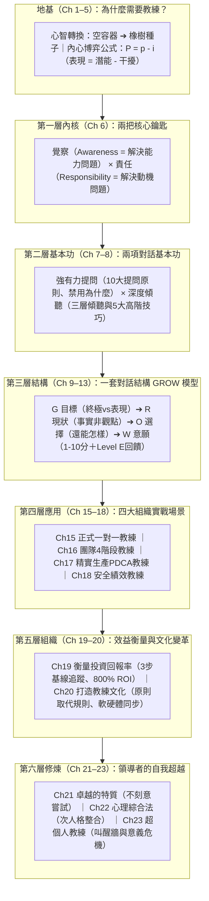

# 《高績效教練（原書第5版）》三源整合精煉版：重點摘要、三檔比較分析與高階經理人教戰手冊

> **知識庫定位**：高階經理人教練手冊入口網站 — **Book #01 核心教材（McKinsey 顧問簡報對應版）**  
> **三份原始文獻交叉整合來源**：
> 1. **【來源 A｜實戰聽書視角】**《高績效教練》廣行解讀（樊登讀書實戰案例與對話逐字稿）
> 2. **【來源 B｜原著權威視角】** 約翰·惠特默（John Whitmore）《高績效教練（原書第5版）》完整 5 大部分、23 章、原書視覺圖表（圖2、表2、圖6）與附錄 PCI 七大教練問題工具箱（PDF 280 頁）
> 3. **【來源 C｜高階顧問視角】**《高績效教練_逐章分析與行動方案.md》（資深創業／企業經營顧問視角之 1–23 章重點摘要、亮點洞察、本週/本月/本季行動方案、KPI 指標、跨書張力對照與 4 大把握度缺口診斷）

---

## 壹、 三份檔案交叉比較與互補修正總表（Three-Source Reconciliation Matrix）

在本次修訂中，我們將三份材料進行嚴格比對，取長補短並消除單一來源的盲點：

| 比較維度 | 來源 A：《廣行解讀.md》 | 來源 B：《原書第5版.pdf》(含圖像還原) | 來源 C：《逐章分析與行動方案.md》 | 整合修正後之最終教材設計 |
| :--- | :--- | :--- | :--- | :--- |
| **核心受眾與視角** | 初認識教練領導力之主管；強調好聽易懂、故事化破題 | 全球企業高管、專業教練；建立完整哲學、心理學與組織變革架構 | 創業者、中小企業主、高階經理人；強調**每週/每月/每季落地行動與量化 KPI** | 兼具**麥肯錫結構化全局觀**、**生動案例故事**與**可量化追蹤的行動方案** |
| **全書結構脈絡** | 聚焦前段核心理念（空容器 vs 橡樹種子、雙開關、GROW 四步） | 5 大部分、23 章、3 大附錄線性展開 | 提煉出**「6 層同心圓結構」**：內核（Ch6）➔ 兩項基本功（Ch7-8）➔ 一套對話結構（Ch9-13）➔ 四大場景（Ch15-18）➔ 投資回報與文化（Ch19-20）➔ 領導者自我修煉（Ch21-23） | 採用來源 C 的**「同心圓架構」**作為全局導覽圖，並嵌入來源 B 的完整章節細節 |
| **經典案例庫** | ① 滑雪教練教網球（3個觀察問題） ② 演講緊張覺察（1-10分、呼吸、表情） ③ **上海專案小張與小王不出活**（揭開老李偏見與最晚進組真相） | 除全書案例外，包含**附錄1（A-W 詞彙表）**與**附錄2（PCI 七大教練問題工具箱）** | 完整萃取各章原書案例： ① **蘇與莫（Ch4）**在職教練 ② **彼得找梯子 & 喬治娜（Ch6）** ③ **跳遠冠軍林·戴維斯（Ch10）** ④ **山姆獨自硬扛與郵件逃避（Ch11, 13）** ⑤ **米歇爾與九點練習（Ch12）** ⑥ **愛麗絲與吉姆精實 PDCA（Ch17）** ⑦ **營運經理肯 £7.8萬回報（Ch19）**與**澳紐銀行（Ch20）** | 將來源 A 的**「上海專案」**與來源 C 整理的**「8 大原書案例」**全面整合為雙案例庫（本土實戰 ＋ 國際原著） |
| **原書關鍵圖表缺口（Gap 1 修正）** | 未收錄原書圖表 | 透過 PDF 頁面影像直接解析還原 **P.52-53 圖2與表2（績效曲線四階段完整矩陣）**及 **P.71 圖6（教練型領導力三角）** | 於文末「缺口 1（把握度 85%）」誠實標註因純文字擷取而缺失圖2、表2、圖6 等視覺圖表內容 | **100% 補齊缺口 1**：以來源 B 的 PDF 影像精確補上「衝動任性／依賴他人／獨立自主／相互依賴」四階段完整對照表，消除 15% 的不確定性 |
| **跨書決策張力與行動過載解方** | 未涉及跨書比較與行動篩選 | 聚焦教練本身，未討論創業早期市場測試的速度張力 | 提出兩大高階洞察： ① **「帶人要慢 vs. 測市場要快」**（與《把熱愛變成事業》對照） ② **「5 大組織現況診斷問題」**，解決 23 章 90 項行動過載問題，每次僅選 3-5 個行動 | 新增專屬簡報頁與首頁互動式**「五問組織現況診斷器」**，自動為高階經理人匹配當季最優先的 3–5 項行動方案 |

---

## 貳、 全書「六層同心圓」核心架構與重點摘要（Executive Summary）

綜合《原書第5版》與《逐章分析與行動方案》，《高績效教練》並非零散的管理技巧，而是以**「覺察與責任」為圓心**向外擴張的**六層同心圓系統**（第 1–5 章則為貫穿全局的「為什麼需要教練」地基）：

### 一、 地基篇（第 1–5 章）：從「空容器」到「橡樹種子」的典範轉移
1. **領導者最常忽略的第四項行為（Ch 1）**：
   - 高管認為最需改變的四大行為依序為：① 時間壓力、② 恐懼、③ 產品品質、④ **員工發展（排在最後！）**。但前三個問題的根源恰恰是第四個——因為不發展員工，領導者才永遠沒時間、品質才永遠靠自己盯。
   - **真自信 vs. 假自信**：地位、頭銜、豪車給的是「外在支撐的假自信」；**唯有擁有實質選擇權並為結果負責，才能建立真自信**。
2. **傳統管理 vs. 教練式管理（Ch 2–3、廣行解讀）**：
   - **傳統控制型管理**把部屬當成**「空容器」**（不灌輸就空空如也），工具只有「命令與告知（Command & Tell）」加「胡蘿蔔加大棒」，結果造就「老闆在就演戲、老闆不在就停擺」的順從者。
   - **教練式管理**把部屬視為**「橡樹種子」**（內部早已具備長成參天大樹的基因密碼），管理者的任務不是替它長樹枝，而是提供陽光、水分與土壤。
3. **內心博弈公式與期望效應（Ch 2, 4, 5）**：
   - 添·高威（Tim Gallwey）公式：$$\text{實際表現 } (P) = \text{內在潛能 } (p) - \text{內外干擾 } (i)$$
   - **滑雪教練教網球的啟示**：完全不懂網球的滑雪教練，不糾正姿勢，只問三個覺察問題（① 球飛來時正轉還反轉？② 過網高度幾公分？③ 落地後轉速變快還變慢？），學員專注觀察後，恐懼與自我懷疑（干擾 $i$）消失，身體本能（潛能 $p$）自然接管。
   - **40% 潛能鐵律與專家陷阱（Ch 5）**：調查顯示員工平均僅發揮 **40%** 潛能（外部障礙是老闆的管理風格，內部障礙是對失敗的恐懼）。**「專家每多輸入一分建議，被教練者的責任感就減少一分。」**

### 二、 原書第 5 版核心新增（Ch 3）：績效曲線四階段完整矩陣（補齊來源 C「缺口 1」）
透過原書 PDF 第 52–53 頁圖像精確還原之**【圖 2 與表 2：績效曲線四階段】**：

| 演進階段 | 員工核心心態語錄 | 整體績效 | 對應馬斯洛需求 | 內心博弈狀態 ($P = p - i$) | 對應之領導風格與組織盲點 |
| :--- | :--- | :--- | :--- | :--- | :--- |
| **1. 衝動任性** *(Impulsive)* | 「無所謂，幹到哪兒算哪兒」 | **低** | 生存需求 | 高干擾 $i$ ／ 低潛能 $p$ | **隨意、不一致**：管理者事必躬親、救火式微觀管理 |
| **2. 依賴他人** *(Dependent)* | 「我遵守規則，按照領導的要求去做」 | **低 – 中** | 歸屬感 | 高–中干擾 $i$ ／ 低–中潛能 $p$ | **命令與控制（交易型）**：等級森嚴、搶地盤、互相指責推諉 |
| **3. 獨立自主** *(Independent)* | 「我是一個高績效的人」 | **中 – 高** | 尊重需求 | 低–中干擾 $i$ ／ 中–高潛能 $p$ | **授權–賦能個人表現**：鼓勵單打獨鬥，但**個人目標常凌駕於團隊利益之上** |
| **4. 相互依賴** *(Interdependent)* | **「我們一起共創成功」** | **極高** | 自我實現 | **極低干擾 $i$ ／ 極高潛能 $p$** | **夥伴與支持（公僕型領導）**：自治團隊、高度信任、願景連結個人／企業／社會 |

---

## 參、 逐章亮點洞察、經典案例與落實行動方案總表（Chapters 1–23 Complete Playbook）

以下整合《逐章分析與行動方案.md》全部 23 章之核心案例、本週/本月/本季行動方案與量化成功指標（KPI）：

| 章節 | 核心主題與關鍵洞察 | 經典實戰案例（原書 ＋ 廣行解讀） | 立即可執行之行動方案（本週 ➔ 本月 ➔ 本季） | 量化成功指標（KPI） |
| :--- | :--- | :--- | :--- | :--- |
| **Ch 1** | **什麼是教練** 員工發展被排在4大改變行為之末；真自信源於選擇權 | 某組織把員工發展列為最後；高管失去頭銜豪車後喪失自信 | **本週**：記錄插手給答案次數 **本月**：選1件低風險決策交部屬自選並複盤 | 每週替部屬做決策次數下降 **50%**；部屬主動提案數 **≥2件/月** |
| **Ch 2** | **打造高績效文化** 內心博弈 $P=p-i$；領導者必須先改變自己 | 添·高威滑雪教練跨界教網球；千禧世代拒絕命令式管理 | **本週**：盤點3個常見「內部干擾」 **本月**：將指責改為「我們從中學到什麼」 | 會議主動發言率提升 **30%**；錯誤主動通報時間縮短 **50%** |
| **Ch 3** | **教練式領導者** 績效曲線4階段；高情商創造78%利潤增量 | 依賴型組織充滿指責；相互依賴型組織共創成功（圖2、表2） | **本週**：評估每位核心成員處於哪一階段 **本月**：對依賴型成員減少50%直接指令 | 依賴型部屬獨立完成任務比例提升 **25%**；團隊推諉事件歸零 |
| **Ch 4** | **教練的本質** 教練不是開車帶人走，而是邊走邊把鑰匙交出去 | **蘇與莫（Sue & Mo）**：莫不給答案，連問「最重要下一步？」「還有呢？」「你學到什麼？」 | **本週**：部屬請示時先問「你覺得最重要的下一步是什麼？」 **本月**：推行「帶問題來，同時帶兩個方案來」 | 部屬請示時自備方案比例達 **80%**；在職教練對話 **≥3次/週** |
| **Ch 5** | **輔導心態** 畢馬威期望效應；員工僅發揮40%潛能；專家輸入降低責任感 | 教師對學生的「潛能期望實驗」；研討會揭露外部障礙是老闆風格、內部障礙是恐懼 | **本週**：找出1位曾被貼「能力不足」標籤的員工，重新列出其3個強項 **本月**：忍住不給專家建議，改用提問引導 | 被重新賦權之員工專案達成率提升 **30%**；領導者說話佔比 **<30%** |
| **Ch 6** | **覺察與責任（全書內核）** 有選擇才有責任；治標不如治本 | ① **彼得找梯子**（命令去拿 vs 誰自願去拿） ② **喬治娜不發備忘錄**（表面問題 vs 抗拒心態） ③ **演講緊張覺察**（呼吸與表情） | **本週**：交辦任務時給部屬「方法選擇權」 **本月**：針對重複犯錯問題，追問背後的「抗拒心態」而非只盯動作 | 任務承諾兌現率達 **90%**；重複性管理問題發生率下降 **40%** |
| **Ch 7** | **強有力提問** 10大提問原則；開放式問題；由廣入深漏斗；禁用「為什麼」 | 射擊運動員覺察「身體晃動毫米數」而非盯靶心；「為什麼」引發防衛，「什麼」引發觀察 | **本週**：將「為什麼沒做好？」全面替換為「發生了什麼？缺了什麼？」 **本月**：桌邊貼10大強有力問題清單 | 對話中開放式問題佔比 **>70%**；部屬防衛性藉口減少 **60%** |
| **Ch 8** | **積極傾聽** 傾聽3層次；高階傾聽5技巧（複述、總結、反映感受、連結、留白） | 領導者常犯「假裝傾聽（邊聽邊想怎麼反駁）」；3–5秒沉默留白是部屬突破盲點的關鍵 | **本週**：一對一談話關閉手機電腦通知，練習提問後**沉默數3秒** **本月**：每次對話至少使用1次「反映感受＋總結」 | 部屬感受到被理解評分（1-10分）**≥8.5分**；領導者打斷次數 **= 0** |
| **Ch 9** | **GROW 模型總覽** 沒有覺察與責任的 GROW 只是偽裝成提問的審訊 | **上海專案小張與小王不出活**（廣行解讀經典案例：以為是員工懶，結果是老李偏見＋最晚進組資訊斷層） | **本週**：檢查自己提問時是否心中早有標準答案（誘導式提問） **本月**：完整走完1次不給建議的 GROW 四步對話 | GROW 對話後部屬自發產出行動方案比例 **100%** |
| **Ch 10** | **G — 設定目標** 終極目標（不可控結果）vs. 表現目標（100%可控行為）；SMART＋PURE＋CLEAR | **1968奧運跳遠冠軍林·戴維斯（Lynn Davies）**：只盯金牌（終極目標）而忽略助跑起跳（表現目標）導致衛冕失敗 | **本週**：將團隊業績目標拆解為100%可控的「表現目標」 **本月**：讓部屬自己提出目標數字（自主目標高於強派目標） | 每位成員皆有明確「表現目標」；目標達成率提升 **20%** |
| **Ch 11** | **R — 釐清現狀** 描述事實而非觀點；不急著解決問題；依賴–獨立–相互依賴光譜 | **山姆（Sam）案例**：工作量暴增卻想靠「自己更努力（獨立）」硬扛，透過現狀釐清轉向「跨部門協作（相互依賴）」 | **本週**：在部屬還沒把現狀講完前，嚴禁跳入「那我們該怎麼辦」 **本月**：要求報告中嚴格區分「客觀數據事實」與「主觀推測」 | 現狀盤點階段找出的真因準確率提升 **50%**；無效加班減少 **30%** |
| **Ch 12** | **O — 探索選擇** 「還有呢？」激發創意；九點練習跳出假設；請求許可才給建議 | **米歇爾（Michelle）對話**：連問「還能怎樣？」逼出5個方案，最後先請求許可才補充第6個；**九點連四線練習**；隨機排列選項避免暗示優先級 | **本週**：討論方案時規定至少列出 **5個選項**（含1個無限制破框方案）才准評估 **本月**：用 1–10 分評估各方案之成本與效益 | 每個議題平均產出選項數 **≥5個**；創新解決方案採納率 **≥30%** |
| **Ch 13** | **W — 強化意願** 1–10分意願測試（<8分必調整）；表揚與回饋5層級（Level A–E）；70:20:10法則 | **山姆想發郵件逃避當面溝通**：教練不批評，只問「發郵件後會發生什麼？」讓山姆自己決定當面談；**Level E 自我評估回饋** | **本週**：所有行動結尾必問「1–10分你有幾分把握會做？」（低於8分當場刪減範圍） **本月**：用 Level E 三問取代傳統批評與空洞誇獎 | 行動方案7天內執行率達 **90%**；Level E 回饋使用率 **100%** |
| **Ch 14** | **意義與目標教練** 意義（過去累積）vs 目的（未來召喚）；受害者轉向創造者；榮格「你抗拒的會持續存在」 | **80歲回望練習**；警告：**永遠不要問部屬一個你自己還沒認真回答過的意義問題** | **本週**：領導者自己先完成「80歲回望練習」 **本月**：在績效面談中加入「這份工作如何連結你的3年人生目標？」 | 核心人才留任率 **≥90%**；團隊工作敬業度（Engagement）提升 **25%** |
| **Ch 15** | **正式一對一教練** 發起人（老闆）、領導者、教練三重角色衝突；保密與心理契約 | 中小企業主身兼「打考績的老闆」與「啟發潛能的教練」，若未先建立「有意識的工作協議」必失敗 | **本週**：與直屬部屬簽訂口頭/書面「工作協議（Working Agreement）」 **本月**：每月固定保留1小時「不談日常進度、只談個人成長」的一對一教練 | 每月正式 1-on-1 教練完成率 **100%**；心理安全感評分 **≥8.5/10** |
| **Ch 16** | **教練式團隊** 舒茨（Schutz）團隊發展4階段（包融➔主張➔合作➔共創）與9項團隊實踐 | 多數團隊卡在「假和諧（不敢主張）」或「山頭內鬥（不會合作）」，無法進入高績效「共創」 | **本週**：用舒茨4階段診斷團隊目前卡在哪一關 **本月**：若卡在「包融」，舉辦深度破冰；若卡在「主張」，建立公開透明的異議規則 | 團隊所處階段於本季推進 **1個階段**；跨部門協作滿意度 **≥8分** |
| **Ch 17** | **精實生產教練** 沒有教練的精實（Lean）只是冷冰冰的壓榨；PDCA 每一步都靠提問驅動 | **愛麗絲與吉姆（Alice & Jim）精實對話**：將模糊的「需要盡可能多的資訊」透過提問收斂為具體的「提前2週拿到排程表」 | **本週**：在流程改善會議中，禁止使用「盡快、盡量、更多」等模糊詞，全數轉化為量化時間與數量 **本月**：將 GROW 嵌入每週 PDCA 改善例會 | 流程改善提案來自一線員工比例 **>70%**；模糊承諾歸零 |
| **Ch 18** | **安全績效教練** 將「我必須遵守（I have to）」轉為「我選擇安全（I will）」 | 傳統安全管理靠罰款與貼標語（依賴階段），一旦沒人看就違規；教練讓員工自己評估風險後果（相互依賴） | **本週**：把合規/資安/工安宣導改為提問：「如果這一步省略，最壞會發生什麼？誰會受影響？」 **本月**：建立不懲罰的「虛驚事件（Near-miss）主動通報學習機制」 | 違規/工安事故率下降 **50%**；主動風險通報數提升 **2倍** |
| **Ch 19** | **衡量教練效益與 ROI** PCI 統計平均 800% 投資回報率；中小企業3步基線追蹤法 | **營運經理肯（Ken）案例**：領導力從 1/10 升至 9/10，提前3年升任董事，為公司創造 **£78,000（約7.8萬英鎊）** 淨效益 | **本週**：為受教練部屬設定1個業務指標＋1個行為指標（1–10分基線） **本季**：3個月後重測並計算時間節省與業績增量之 ROI | 行為指標平均提升 **≥3分**；高管每週救火時間減少 **5–10小時** |
| **Ch 20** | **打造教練文化** 交易型變革必敗（只改硬體制度或只改軟體行為）；用「原則」取代僵化「規則」 | **澳紐銀行（ANZ Bank）文化轉型**：將核心價值觀轉化為具體行為原則；同步改革制度（硬體）與心態（軟體） | **本週**：盤點公司內1條「防弊卻阻礙興利」的僵化規則，改寫為「指導原則」 **本季**：將「發展部屬的教練表現」納入主管績效考核權重（≥20%） | 主管考核含教練指標比例 **100%**；跨部門文化健康度提升 **20%** |
| **Ch 21** | **卓越領導者的特質** 「不刻意嘗試（Non-trying）」：用1–10分不評判自我觀察，直接跳過「有意識無能力」的掙扎期 | 傳統學習4階段在「有意識無能力➔有意識有能力」最痛苦易放棄；高威發現**只觀察打分（1-10分）而不批判**，大腦自動優化動作；卡尼曼（Kahneman）指出「恐懼扼殺學習，樂趣創造巔峰表現」 | **本週**：選定1個想改掉的領導壞習慣（如打斷別人），每天只記錄「今天專注傾聽得幾分（1-10分）」，不自責 **本月**：在團隊導入「無批判1-10分自我覺察日誌」 | 領導者目標習慣評分於4週內從 **4分升至8分以上** |
| **Ch 22** | **心理綜合法（Psychosynthesis）** 阿薩吉奧利次人格理論；把內心衝突從「我有病」轉化為「我內在兩個角色的對話」 | 領導者常陷入「嚴厲控制狂次人格」與「渴望被喜愛次人格」的內耗；認出並命名次人格，才能拿回「自我（Self）」指揮權 | **本週**：當對部屬感到強烈憤怒或焦慮時，問自己：「現在是我裡面的哪個角色（次人格）在握方向盤？」 **本月**：練習整合兩個衝突的次人格，找出它們背後共同的善意 | 情緒失控或衝動決策次數 **= 0**；高壓決策清晰度提升 |
| **Ch 23** | **超個人教練與未來領導力** 雙軸成長模型（世俗成就軸 vs 內在覺醒軸）與「叫醒牆（Wake-up Wall）」意義危機 | 許多創業者與高管在事業登頂時撞上「叫醒牆」（成功卻空虛、生病、倦怠），這不是失敗，而是生命要求從「個人成就」轉向「服務更大整體（公僕型領導）」的訊號 | **本週**：誠實檢視自己是否正處於「高世俗成就、低內在意義」的叫醒牆前兆 **本季**：將企業願景從「賺多少錢」升級為「為客戶、員工與社會解決什麼根本問題」 | 高階經營團隊願景共識度 **≥9/10分**；個人倦怠感顯著下降 |

---

## 肆、 跨書策略對照：與《把熱愛變成事業》之張力與互補（「帶人要慢 vs. 測市場要快」）

根據《逐章分析與行動方案.md》之高階整合洞察，高階經理人與創業者在同時閱讀《高績效教練》（約翰·惠特默）與《把熱愛變成事業》（凱莉·彭）時，必須掌握一個極為關鍵的**雙軌決策矩陣**：

| 決策維度 | 《高績效教練》（對內帶人：組織與人才發展） | 《把熱愛變成事業》（對外測市場：產品與商業驗證） | 高階經理人／創業者的雙軌整合法則 |
| :--- | :--- | :--- | :--- |
| **對「速度」的態度** | **必須慢下來（Go Slow to Go Fast）** 忍住直接給答案的衝動，花 15 分鐘提問，換取部屬長期的責任感與獨立思考能力。 | **必須快起來（7天最小可行測試 MVP）** 先發帖、先收錢、先用《媽媽測試》驗證真需求，嚴禁閉門造車完美主義。 | **黃金分野法則**：問自己「我現在是在**培養人**，還是在**測試市場**？」 • **對內帶人要慢**（用 GROW 提問） • **對外測市場要快**（用最小測試驗證） |
| **對「專業知識」的態度** | **專家知識是教練的最大誘惑與干擾** 「專家每多輸入一分，部屬的責任感就少一分。」必須把專業收起來，先問部屬怎麼看。 | **專業術語是流量的毒藥** 專家最愛講行話，但客戶只關心「你能幫我解決什麼痛點」，必須用大白話溝通。 | 無論對內帶部屬或對外對客戶，**「收起專家傲慢、從對方的覺察與真實痛點出發」**是完全一致的底層邏輯。 |
| **目標設定邏輯** | **終極目標（金牌）＋ 表現目標（100%可控動作）** 把不可控的營收拆解為每天可控的高品質行為。 | **年收入倒推法 ＋ 每日/每週可執行動作** 將財務自由目標拆解為每週發幾篇內容、聊幾個潛在客戶。 | 用《高績效教練》的**「表現目標」**確保團隊不因短期市場波動而恐慌；用《把熱愛變成事業》的**「市場測試指標」**確保方向不偏離真實需求。 |

---

## 伍、 消除「90項行動過載」：高階經理人「五問組織現況診斷器」

《逐章分析與行動方案.md》於「缺口 3 與缺口 4」特別警示：全書 23 章共提煉出近 **90 個行動項目**，若高階經理人試圖同時執行，必然導致「行動過載而全面放棄」。因此，在啟動任何教練行動前，必須先回答以下 **5 個組織現況診斷問題**，每次**只挑選 3–5 個最關鍵的行動**執行一季：

1. **【診斷問題 1｜團隊規模與層級】你的團隊目前有幾人？是否有中階主管層？**
   - *10 人以下扁平團隊*：優先執行 **Ch 4（蘇與莫隨手教練）＋ Ch 6（彼得找梯子交還選擇權）＋ Ch 13（1–10分意願測試）**。
   - *20 人以上多層級組織*：優先執行 **Ch 15（三重角色工作協議）＋ Ch 16（舒茨團隊4階段）＋ Ch 20（將教練納入中階主管考核）**。
2. **【診斷問題 2｜救火時間佔比】你每週花多少比例的時間在「替部屬救火、改東西、給答案」？**
   - *救火佔比 > 40%（重度微觀管理）*：立刻啟動 **Ch 7（禁用為什麼、改問發生什麼）＋ Ch 8（提問後沉默 3 秒）＋ Ch 9–13（要求部屬帶著 GROW 方案來請示）**。
3. **【診斷問題 3｜績效曲線階段】你的核心團隊目前處於績效曲線的哪個階段？**
   - *處於「依賴他人（等指令、推卸責任）」*：先用 **Ch 5（撕掉負面標籤）＋ Ch 6（賦予小範圍方法選擇權）**建立安全感與真自信。
   - *處於「獨立自主（明星員工單打獨鬥、搶功）」*：啟動 **Ch 11（山姆案例：轉向相互依賴）＋ Ch 16（團隊共創實踐）**。
4. **【診斷問題 4｜現有績效制度】公司目前是否有明確的 KPI / OKR 制度？**
   - *只有結果數字（只盯營收，員工壓力大且造假）*：導入 **Ch 10（拆解 100% 可控的表現目標）＋ Ch 13（Level E 自我評估回饋）**。
   - *正在推行流程改造或安全合規*：導入 **Ch 17（愛麗絲與吉姆精實 PDCA 提問）＋ Ch 18（從我必須到我選擇）**。
5. **【診斷問題 5｜領導者個人狀態】你本人目前是否感到「事業有成但內心疲憊、易怒或空虛」？**
   - *出現情緒內耗或倦怠前兆*：暫緩對外折騰制度，先執行 **Ch 21（不刻意嘗試：1–10分無批判自評）＋ Ch 22（次人格覺察）＋ Ch 23（叫醒牆與 80 歲回望練習）**。

---

## 陸、 原書附錄精華：PCI 七大教練問題工具箱（Appendix 2 Quick Reference）

1. **工具一：自我教練（Self-Coaching）**：我想要什麼？什麼在阻礙我？我是怎麼干擾自己的？我現在能做什麼？
2. **工具二：有意識的工作協議（Working Agreement）**：要讓這次合作真正成功，我們需要達成什麼共識？當遇到困難時我們如何坦誠反饋？
3. **工具三：請求許可（Asking Permission）**：我可以分享一個觀察嗎？你願意聽聽另一個視角的想法嗎？
4. **工具四：十大強有力問題（Top 10 Powerful Questions）**：
   - 如果我知道答案，那會是什麼？｜這裡真正的挑戰是什麼？｜什麼是我還沒看到的？｜如果沒有任何限制，我會怎麼做？｜**還有呢？（And what else?）**
5. **工具五：GROW 四階段實戰題庫**：
   - **G**：這次談話結束時你最想帶走什麼？哪些是你 100% 可控的表現目標？
   - **R**：目前客觀事實是什麼？你已經試過什麼？別人怎麼看？
   - **O**：有哪些可能做法？還有呢？如果預算/時間減半或加倍，你會怎麼做？
   - **W**：你決定選哪一項？第一步在幾月幾日幾點做？**1–10 分你有幾分把握？怎樣才能提高到 8 分以上？**
6. **工具六：後續跟進三情境（Follow-up）**：
   - *成功時*：你最滿意哪一部分？你是怎麼做到的？
   - *未達標時*：發生了什麼？你從中學到什麼？下一步怎麼調整？
   - *完全沒做時*：是什麼阻礙了你？這個目標對你還重要嗎？
7. **工具七：Level E 高績效回饋三問（GROW Feedback）**：
   - ① 回顧這次表現，**你最喜歡自己做的哪個部分？**
   - ② 如果重來一次，**你會在哪裡用不同的方式處理？**
   - ③ 從這次經驗中，**你總結出什麼原則可以帶到下一次？**
