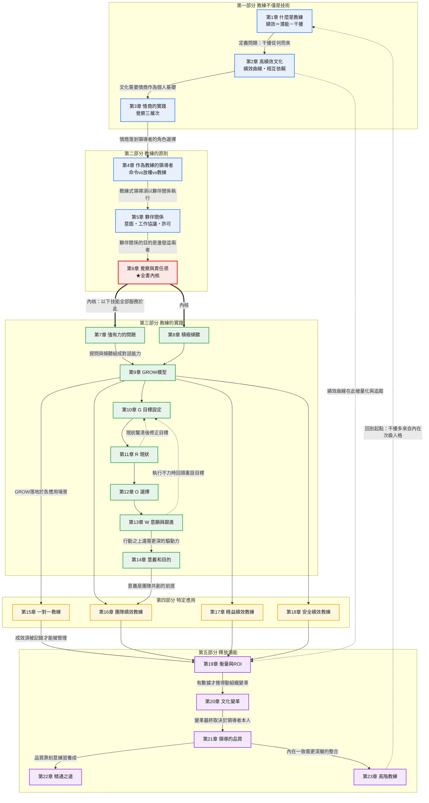

# 《高績效教練（原書第5版）》逐章分析與行動方案

- **書名**：高績效教練（Coaching for Performance，原書第 5 版）
- **作者**：【英】約翰·惠特默爵士（Sir John Whitmore）
- **出版**：機械工業出版社·華章圖文，2018 年 12 月
- **分析日期**：2026-08-16
- **分析視角**：資深創業顧問｜服務對象＝創業者／中小企業經營者，正想把教練式領導導入自己的團隊管理
- **原則**：僅依原書內容分析；凡屬顧問延伸推論者均予標示。

---

## 第一部分：教練不僅僅是一門技術

### 第1章：什麼是教練

**重點摘要**

- 高威的內心博弈方程式：績效＝潛能－干擾（P＝p－i），教練的核心是「開發潛能」與「減少干擾」，而非灌輸技術。
- 教練與導師輔導不同：導師靠「經驗更豐富的人傳授知識」，教練則不必精通某專業學科，重點在於知道何時該分享知識、何時不該。
- 教練式領導對應馬斯洛需求層次：停留在「地位與認可」層次會傲慢、以自身利益為先；進入「自信／自尊」層次才會做對的事而非表面文章；「自我實現」層次則進入服務他人、相互依賴的境界。
- 自信的建立來自「真正擁有選擇權」，而非威望與特權；下命令的方式剝奪選擇權，使人潛能受限、失去動力。
- 千禧世代及後續世代員工更追求工作的意義與目的，面試時會關注培訓發展機會與領導風格，需求得不到滿足就會離職。
- 領導者最需要改變的 4 個行為模式中，員工發展排在最後（優先序：時間壓力、恐懼、工作／產品品質、員工發展），這是命令控制文化持續存在的主因。
- 教練的本質是「幫助人們學習而不是給他們授課」；人類天生具備學習能力，過度指導反而破壞這種能力。

**亮點洞察**

- 「自信建立在真正的選擇權上，不是頭銜或特權」——很多老闆以為升職加薪、給頭銜就等於授權，但若沒有配套的實質決策權，反而打擊積極性。創業者常見誤區是用「加薪／升遷」取代「放手讓人做決定」，兩者不能互相替代。
- 「員工發展在四個領導行為模式中排最後」對中小企業經營者特別扎心——多數創業者會說重視人才發展，但實際的時間與精力永遠先給救火、業績、恐懼驅動的事。這種言行不一致正是教練文化建立不起來的根因，而不是「不懂教練技巧」。
- 教練與導師的界線常被混淆：習慣用「我來教你怎麼做」帶團隊，會複製老闆自己的能力天花板；教練式提問反而能挖出老闆自己都沒想到的解法。

**落實行動方案**

- 本週：列出目前以「直接下指令」方式管理的前 3 位核心成員，針對他們各自負責的 1 個當前決策，改用提問取代直接給答案。成功指標：一週內完成至少 3 次「提問取代指令」的對話，並書面記錄對方提出的方案是否可行。
- 本月：與每位核心員工進行一次一對一，直接詢問「你希望在這份工作中獲得什麼樣的成長與發展機會」並記錄，比對是否與公司現有培訓資源相符。成功指標：完成率 100%。
- 本月：檢視公司內所有「頭銜／職位晉升」是否都伴隨對應的實質決策權（預算簽核、招募、專案決定），列出不對等案例並至少修正 1 個。成功指標：至少 1 個職位的決策權範圍被書面重新界定並公告。

---

### 第2章：創造高績效的文化

**重點摘要**

- 高績效文化的核心是組織思維從「依賴」轉向「相互依賴」，領導者的教練式行為是關鍵槓桿（研究顯示領導行為對企業業績的影響高達 30%）。
- 指責文化會激發自我防衛、降低自我覺察，導致沒有準確的資訊回饋、無法自我調整，是根本性文化變革的最大阻礙。
- 壓力與缺乏個人自主高度相關：在工作中盡可能給予他人選擇與支配的權力、認可並尊重其能力與自尊，能有效降低壓力。
- 「績效曲線」將組織文化分為 4 個發展階段，領導者需先辨識自己團隊目前主導的思維模式，才能推動改變（自我覺察是改變的前提）。
- 實際案例：林德公司將教練引入安全文化培訓，用「好奇心與夥伴關係」取代「評判與責備」，事故率下降 74%；米其林在 6 國工廠以信任取代等級制度，團隊自主努力帶來 10 倍回報。
- 「如果你無法衡量它，你就無法管理它」——大多數企業空談文化改變，卻很少真正主動衡量並管理自己的組織文化。

**亮點洞察**

- 指責文化與壓力的連結最容易被忽略：多數老闆把「工作壓力大」歸因於工作量或市場競爭，卻沒意識到自己習慣性的指責式管理才是壓力與低自尊的主因（書中引用加拿大公共雇員聯盟調查：「缺乏教練輔導」與「低自尊」是工作壓力主因）。這意味著減壓不是靠「少分派工作」，而是靠改變回饋方式。
- 「文化必須被衡量才能被管理」——絕大多數中小企業從未系統性衡量過自己的組織文化（只有口號、沒有數據）。常見盲點是把文化當成「感覺」而非可衡量的管理指標。
- 米其林案例中「不發布命令感覺像失去了權力，但我們從團隊的自主努力中獲得了 10 倍的回報」——這句話點出創業者放手時最真實的心理障礙：恐懼失控。書中不迴避這種不適感，比單純鼓吹「要授權」更務實。

**落實行動方案**

- 本週：召集核心管理團隊，用績效曲線的邏輯（可簡化為依賴／獨立／相互依賴三階段），讓每位主管寫下「我們團隊目前主導的思維模式是什麼」，比對彼此答案。成功指標：完成一次不少於 1 小時的討論，產出一份對目前文化階段的共識文件。
- 本週：回顧過去一個月你對員工失誤的 3 次真實反應（口頭或訊息紀錄），標記屬於「指責／批評」還是「好奇提問」，計算指責式反應佔比。成功指標：完成自我審視紀錄，並訂出下月要降低的具體數字目標。（顧問延伸推論，非書中原文：書中未提供量化佔比方法，僅有調查與研究作為定性依據）
- 本月：挑選 1 個目前用「規則與監督」管理的流程，試行以信任取代等級制度——去除一層不必要的簽核，直接授權執行者自主決定，觀察 1 個月後的產出品質與員工回饋。成功指標：該流程審批時間縮短，且員工主動回報問題的頻率有可衡量的變化。

---

### 第3章：教練是情商的實踐

**重點摘要**

- 情商在預測領導者卓越表現方面的重要性是智商的兩倍；在工作中，情商對績效的重要性是理論知識或專業技術的兩倍（66% 比 34%），對高管「最佳表現」的影響超過 85%。
- 情商可劃分為 4 個領域：自我覺察、自我管理、人際覺察、關係管理；教練方式正是培養情商並創造高績效的最有效途徑。
- 覺察分 3 個層次：自我覺察（理解自己為何做出某些行為、認識內在干擾與偏見）、覺察他人（識別他人優勢、干擾與動機）、組織覺察（協同個人／團隊／組織目標）。
- 「體驗情商」活動顯示：人們記憶中影響自己最深的人物，共通特質是「傾聽我、相信我、挑戰我、信任且尊重我、全心關注我、平等對待我」。
- 面向未來的成功領導者將以教練方式引領而非指揮控制，因為人才對「如何被對待」的期望正快速提升。
- 即使組織在認知上已認同教練型領導的價值，實際落地依然困難，領導者和追隨者有時會共同抵制變革（即使變革對雙方都有利）。

**亮點洞察**

- 「情商對績效的貢獻是專業技術的兩倍（66% 對 34%）」對創業者是反直覺但關鍵的提醒：多數中小企業主招聘、晉升主管時仍高度偏重專業能力與資歷，卻很少評估或培養情商，這與書中數據直接矛盾，是資源錯配的典型。
- 「體驗情商」的 6 項特質中，最常被忽略的是「挑戰」與「全心關注」——多數老闆容易做到給資源、給信任，卻很少花整段不受打擾的時間專注傾聽一個員工，也很少敢於直接挑戰員工突破舒適圈。
- 「領導者和追隨者有時會共同抵制變革」揭穿一個常見迷思：以為只要老闆帶頭想改變，團隊就會跟著改變。下屬也可能習慣依賴命令式管理帶來的「不用負責」的舒適感，因此推動教練文化需要雙向的心理準備。

**落實行動方案**

- 本週：挑選 1 位主管或關鍵員工，安排一次至少 30 分鐘、不被打斷（手機收起）的一對一，全程只問開放式問題並傾聽，不給建議、不打斷、不評判。成功指標：記錄對方在對話中主動提出的洞察或想法數量（目標至少 3 個）。（顧問延伸推論，非書中原文：具體時長與次數為建議，書中僅強調「全身心關注」）
- 本月：在下一輪招聘或晉升評估中，新增至少 1 項情商相關評估維度（透過情境提問觀察自我覺察或同理心），而非只看技能與資歷。成功指標：至少 1 次決策中，情商評估被正式納入評分表並留下書面紀錄。
- 本月：對照「體驗情商」6 項特質自我評分 1–5 分，找出最低的 1 項，訂出 1 個月改善行動。成功指標：月底重新自評，並請 1 位員工給予匿名回饋佐證。

---

## 第二部分：教練的原則

### 第4章：作為教練的領導者

**重點摘要**

- 管理光譜的兩端——「命令」與「放權」——各有代價：命令快速但被記住的比例極低，且下屬只在被監督時服從；放權則常因下屬缺乏認知而表現不佳。
- 教練式領導不是光譜中間的折衷，而是完全不同的維度，能同時兼顧命令的掌控感與放權的自主性。
- 教練型領導者透過提問讓下屬自己意識到工作全貌與應採取的行動，領導者反而更了解實情、掌握更多實質（而非虛幻）的控制權。
- 領導者的任務只有兩件事：完成工作、發展人才。多數領導者被「救火」綁架，沒時間做長遠規劃與人才培養。
- 教練輔導下屬承擔更多責任，能讓領導者脫離救火角色，把時間騰出來處理只有自己能解決的問題——這是自利最大化，不是理想主義。
- 何時該教練、何時該直接告知有明確判準：時間急迫時直接告知效率最高（但長期養成依賴）；要品質、要學習效果、要對方真正承諾、要留才敬業度時，教練效果最好。
- 蘇與莫的案例顯示，教練式對話（提問、認可、追問「還有什麼」）比直接給答案更能建立責任感與相互依賴的高績效文化。

**亮點洞察**

- 「教練節省的是長期時間，命令節省的是短期時間」——多數經營者只算短期帳，結果員工永遠學不會獨立判斷，老闆變成永遠的救火隊長。每一次「我直接告訴你怎麼做」都在替未來累積一筆依賴債。
- 五個判準（時間／品質／學習／承諾／留才）提供了可操作的決策框架，讓經營者不必非黑即白地選邊，而是依情境切換——這是多數導入教練文化失敗的公司缺少的一步。
- 蘇與莫的對話有一個常被忽略的細節：莫全程沒給任何答案，只問「還有其他的嗎」「你認為怎樣才能」，並在蘇成功後追問「你從這個過程中學到了什麼」——把每次任務都變成一次學習萃取。多數主管在下屬解決問題後就結案，漏掉了複利最高的那一步。

**落實行動方案**

- 本週：列出過去兩週對下屬下達過的所有「直接指令」，用五判準逐一檢視，標出哪些其實應該用提問取代。成功指標：找出至少 3 個可轉換的情境。
- 本月：選定 1–2 位核心幹部，在他們下次回報問題卡關時，以「你認為接下來最重要的是什麼？」取代直接給解法，事後補問「你從這裡學到了什麼？」。成功指標：一個月內至少完成 4 次這類對話並記錄下屬答案，用以檢驗思考深度是否隨時間提升。
- 本月：盤點每週花在「救火」的時數，設定具體目標（例如佔比從 60% 降到 40%），把省下的時間明確劃給「教練輔導」與「長遠規劃」並寫入行事曆。成功指標：一個月後回顧行事曆，救火時數佔比確實下降，且教練時段有被實際使用。
- 本季：針對每位核心幹部，明確寫下「這個人適合用教練還是告知」的初步判斷及理由，避免一套風格套用在所有人身上。成功指標：季末檢視是否有需要調整的判斷，調整理由是否基於具體行為觀察。（顧問延伸推論，非書中原文）

---

### 第5章：教練風格：夥伴關係與相互合作

**重點摘要**

- 教練風格的核心是夥伴關係與相互合作，而非指揮與控制；這能建立相互依賴的文化，取代對領導者的依賴文化。
- 外部激勵（胡蘿蔔加大棒）效果遞減，尤其在加薪、晉升空間受限的環境下；真正的高績效來自自我激勵，而自我激勵無法被強迫產生。
- 領導者對他人潛能的信任會直接影響對方的實際表現（書中引用教育實驗：老師被告知學生是「資優生」或「學習困難」，後續成績果然印證了預期）。多數績效評估系統的缺陷在於根據「過去表現」而非「潛能」評價員工。
- 工作坊學員自評平均只發揮了 40% 的潛能，主要外部障礙是「公司／上司的管理風格」「缺乏鼓勵和機會」「組織結構限制」，主要內部障礙是恐懼。
- 建立信任文化需要三個具體工具：設定明確意圖（會議前先定義「理想結果」）、有意識地建立工作協議（而非預設默契）、以及「請求許可」（分享建議前先問對方是否需要）。
- 「好奇而非批評」是維持夥伴關係的關鍵；人對自己的批評往往比對他人苛刻十倍，教練的任務是幫助對方管理內在的批評聲音而非外加更多評判。

**亮點洞察**

- 「員工平均只發揮 40% 潛能」是警鐘——限制表現的往往不是能力，而是管理風格造成的恐懼。常被忽略之處：經營者通常把低績效歸因於員工能力或努力不足，很少檢視自己是否透過管理行為（如只給員工做他擅長的事）在無意中鞏固了對方的能力天花板。
- 「許可」這個工具價值被嚴重低估。多數創業者習慣「我是老闆，我懂得多，直接說」，卻不知道這種不請自來的建議恰恰在剝奪員工的責任感——書中明確指出「每一次輸入都在減少對方的責任感」。
- 有意識地建立工作協議（先談「夢想長什麼樣」「噩夢長什麼樣」「艱難時我們會做什麼」）在多數中小企業完全缺席——新人到職或組建新團隊時大家直接埋頭做事，從不對齊期待，直到衝突發生才發現彼此假設完全不同。這一步成本極低，卻常被認為「浪費時間」而跳過。

**落實行動方案**

- 本週：針對 1 位你認為「表現平庸」的員工，反思你是否只分派給他熟悉、低風險的任務，主動安排一項稍微超出他過往範圍的任務，並明確告知你相信他能做到。成功指標：記錄他的實際表現是否超出你原本的預期。
- 本月：與 2–3 位核心成員進行一次「有意識工作協議」對話，套用書中六個問題（夢想／噩夢／最佳方式／避免噩夢要注意什麼／彼此需要的許可／艱難時怎麼做）。成功指標：完成後雙方各自寫下協議重點，並排定一個月後的複盤時間點。
- 本月：在下次想直接給建議之前，練習先問「如果我分享一個我覺得有用的想法，對你會有幫助嗎？」，刻意練習至少 5 次並記錄反應。成功指標：記錄這 5 次中對方主動要求你分享的比例，以及該建議是否真被採納執行。
- 本月：用書中三問題（「你發揮了自己百分之多少的潛能」「什麼阻礙了你」「主要的內在障礙是什麼」）對 3–5 位核心員工做匿名調查，彙整外部與內部障礙分佈。成功指標：找出至少一項可由公司立即調整的外部障礙，並在下月啟動調整。（顧問延伸推論，非書中原文）

---

### 第6章：覺察與責任感——激發學習

**重點摘要**

- 覺察和責任感是所有高績效表現最關鍵的兩個態度因素（書中引用赫梅里對 63 位世界頂級選手的研究）。
- 覺察的定義是「有意識地擁有知識」；「我只能掌控我覺察到的一切，我覺察不到的東西掌控著我」——教練的第一步永遠是先建立覺察，而不是直接給答案。
- 傳統管理者透過「告知」否定了對方的自我覺察與自我負責，這種模式壓制責任感，即使短期看似有效，也讓對方失去自主學習的機會。
- 責任感必須來自主動選擇，而非被命令或被賦予；書中彼得找梯子的案例證明，「被要求自願承擔」比「被下令執行」更能激發主動找解方的責任感。
- 「輸入品質」決定「輸出品質」：自己親眼觀察得到的資訊，遠比被別人告知的更豐富、更真實、更能驅動行動改變。
- 教練不需要具備該領域的專業知識才能有效——滑雪教練代打網球課的案例顯示，不懂技術細節反而讓教練更聚焦在提升學員的自我覺察。
- 表象問題背後常有更深層的根本原因（喬治娜案例：表面是「不溝通」，根本是「抵觸心態」），只處理表象（要求寫備忘錄）無法真正解決問題。

**亮點洞察**

- 「知識的陷阱」對創業者特別致命——越是身兼專家與老闆，越容易在下屬遇到問題時忍不住直接給答案。書中明確指出「每一次專家輸入都在減少教練對象的責任感」，這是多數技術背景創業者轉型當管理者時最大的盲點：他們以為「懂得多」是優勢，卻沒發現這個優勢正在系統性削弱團隊的獨立解決問題能力。
- 「表象問題 vs 根本原因」提醒：遇到員工執行力或行為問題時，直覺開出的解方（寫報告、訂 SOP、加強考核）常只是治標。多數中小企業主習慣用「制度」解決「人」的問題，反而讓根本原因被制度掩蓋、持續發酵。
- 彼得找梯子的案例揭示一個極簡單卻極少被實踐的動作：把命令句改成問句（「去拿梯子」→「誰願意去拿梯子」）。這個成本幾乎為零的行為改變常年被忽略，因為「用問的」感覺比較沒效率、沒權威感。

**落實行動方案**

- 本週：選定至少 3 個原本會用「命令句」交辦的任務，改用「誰願意／你覺得該怎麼做」的問句形式，觀察對方是否更主動排除障礙。成功指標：3 件任務中至少 1 件對方在遇到阻礙時主動找替代方案，而非直接回報「做不到」。
- 本月：針對一個反覆出現的員工「執行力問題」，暫停用制度手段處理，改用至少一次一對一提問對話找出根本原因。成功指標：對話後能明確寫下一句「真正的根本原因是＿＿」，而非停留在表象描述。
- 本月：自我審視過去一個月有多少次下屬帶問題來找你、你直接給答案而非先問對方怎麼看；挑選其中 3 次，下次類似情況改用提問。成功指標：記錄提問後對方方案的品質與可執行度，並與你原本會給的答案比較差異。

---

## 第三部分：教練的實踐

### 第7章：強有力的問題

**重點摘要**

- 指導或命令（如「盯住球」）無法改善表現，提問才能促使人真正思考、觀察並產生覺察與責任感。
- 開放式問題（要求描述性答案）優於封閉式問題（是／否），後者會關閉進一步探索的大門。
- 問題應以「什麼」「何時」「誰」「多少」開頭，避免「為什麼」（易引發防禦）和「如何」（易觸發分析性思考而非觀察）。
- 提問應由寬泛逐漸聚焦到細節，細節能讓對方保持專注與興趣；最簡單有力的問題之一就是「還有呢」。
- 問題方向應跟隨教練對象的興趣與議程，而非教練自己的想法，否則會削弱對方的責任感。
- 應避免引導性問題與暗含批評的問題（如「你到底為什麼要這樣做」），這類問題會降低信任。
- 關鍵變量（如「你是如何傾聽的」）比直接要求結果（如「更有禮貌」）更能提升覺察與績效。

**亮點洞察**

- 「不告知，只提問」對創業者是反直覺的。老闆習慣直接下指令（等同「盯住球」），覺得效率最高，但這讓員工不主動思考、不建立責任感，最終所有問題還是回到老闆身上。這是大部分中小企業主管理疲於奔命的根源。
- 「跟隨教練對象的議程，而非教練自己的議程」尤其難做到——創業者對業務有強烈主見，提問時很容易變成引導式提問，實質上是換個方式下命令。這種偽提問員工會迅速識破，反而破壞信任。
- 「為什麼」要換成「是什麼原因」，這個具體技巧常被忽略。多數老闆質問「你為什麼會這樣做」時以為在了解狀況，其實已觸發防禦心理，得到的答案多半是辯解而非真實資訊。

**落實行動方案**

- 本週：挑選近期最常對員工說的 3 句指令型語句，逐一改寫成開放式問題（以「什麼」「如何做」開頭）。成功指標：寫出至少 3 組「命令→提問」對照，並在下週開始實際使用。
- 本月內：在每次一對一或例會中禁止自己使用「為什麼」開頭的問句，改用「是什麼原因」「做這件事情的步驟是」。成功指標：自我記錄兩週，追蹤「為什麼」使用次數是否降到零。
- 本月內：針對一位表現不如預期的員工，安排一次 20 分鐘對話，全程只問問題不給建議，記錄他自己說出的解決方案數量。成功指標：你的發言少於 30%，對方提出至少 2 個自己想到的行動方案。

---

### 第8章：積極傾聽

**重點摘要**

- 真正的傾聽極為稀有，多數人「傾聽」時其實在等待自己發言的時機，或忙著準備建議。
- 教練提問若是「準備好的問題」而非源自當下的專注傾聽，會破壞對話流暢度，對方會察覺你沒在聽。
- 傾聽不只聽內容，還要聽語調、措辭選擇（負面詞彙、由開放轉拘謹）所透露的情緒與心理狀態。
- 需觀察身體語言（身體前傾、手遮口、雙臂交叉）；當言語與肢體語言矛盾時，肢體語言更接近真實想法。
- 教練需階段性地「回顧」總結對話要點，確保理解正確，並讓對方感到被完全聽到。
- 教練必須具備自我覺察，監控自己的情緒反應（緊張的肩膀、胃部抖動），避免主觀偏見影響客觀判斷。
- 投射、移情與反向移情都會扭曲管理與教練關係，尤其常見於權力不對等的上下屬關係。

**亮點洞察**

- 「聽說之比應為 2:1」對創業者是極具張力的提醒。多數老闆習慣主導對話、給答案、下指示，這是創業初期單打獨鬥養成的習慣，但在帶團隊時會直接壓制員工的思考與責任感，是「教練式領導」最大的行為障礙。
- 「言語與肢體矛盾時，肢體語言才是真的」——經營者常只聽員工嘴上說「沒問題、我可以」，卻沒注意抗拒或焦慮的肢體訊號，導致執行落差被忽視到爆發才處理。
- 權力轉移的無意識反應（暗中抵制、消極怠工）在有明顯位階差的關係中特別容易發生，這解釋了很多創業者百思不解的「員工表面聽話、執行卻走樣」現象。

**落實行動方案**

- 本週：選一場你原本會主導發言的會議或一對一，刻意練習「先聽完整段話再回應」，中間不打斷、不急著給建議。成功指標：全程你的發言時間占比控制在 30% 以下（可錄音回放計算）。
- 本月內：在與核心主管的一對一中加入「重述／複述」步驟——對方講完一段後，先用自己的話覆述重點再確認「我這樣理解對嗎」。成功指標：連續 4 次一對一都執行覆述，並記錄至少 1 次因覆述而發現自己誤解對方意思的案例。
- 本月內：針對 1–2 位你懷疑「口頭同意但心裡有抵觸」的員工，安排非正式對話時特別觀察肢體語言，事後寫下觀察紀錄並在下次對話中用開放式問題求證。成功指標：完成至少 2 次觀察紀錄，並至少 1 次驗證出言語與肢體不一致的落差。

---

### 第9章：GROW模型

**重點摘要**

- GROW 代表目標（Goal）、現狀（Reality）、選擇（Options）、意願（Will，作者稱之為「轉化」——意圖轉化為行動）四階段提問順序。
- 教練可以是非正式、融入日常互動的領導方式，也可以是正式安排的結構化會談。
- 目標設定要放在現狀分析之前，因為僅基於現狀推導出的目標容易偏向負面、受限於過去表現、缺乏創新。
- GROW 本身不是萬靈丹：若缺乏積極傾聽與強有力問題所建立的「覺察」與「責任感」為基底，模型會被濫用——書中舉例一個專制老闆完全照 G-R-O-W 順序寫命令，但沒提出任何問題、沒創造任何覺察，員工依然沒有選擇權。
- GROW 可循環使用、不必嚴格照順序：現狀分析可能讓目標變得清晰而需回頭修正；方案執行中若自我激勵感低，也應回頭重新核查目標。
- 成功運用 GROW 的關鍵是先花足夠時間探索「G」，直到目標既能激勵對象、又有可行性。

**亮點洞察**

- 「專制老闆版 GROW」的案例極具警示性——很多創業者以為自己在「用架構管理」，實際上只是把命令包裝成 GROW 的四個字母，完全沒有提問、沒有創造覺察。這是套用管理工具卻沒有改變管理本質的典型陷阱，值得所有正在學教練式管理的經營者對照自檢。
- 「模型可以循環使用，不必死守順序」常被誤解。很多初學者以為 GROW 是必須嚴格走一遍的 SOP，結果談話生硬卡頓；書中明確說應憑直覺在必要時重新審視任何一步，這對忙碌的創業者是重要的減負提醒。

**落實行動方案**

- 本月內：選定 1–2 位核心主管，對其中一項近期卡關的任務，用 GROW 四階段進行一次至少 30 分鐘的正式教練對話，全程用提問代替指示。成功指標：對話結束前由對方自己說出具體的下一步行動與時間點，而非由你替他決定。
- 本週：自我審查上一次交辦任務或下達目標時的說法，對照「專制老闆版 GROW」的四句話模式，誠實評估自己是否也是「宣布目標－指責現狀－替員工想好方案－下命令」。成功指標：寫下具體對照，標示哪一句你也說過，並針對該句改寫成一個開放式問題。
- 本月內：為某個部門製作一份「教練對話追蹤表」，記錄每次對話所在的 GROW 階段、是否需要回頭修正目標。成功指標：累積至少 3 筆紀錄，並至少有 1 筆記錄到「因現狀分析而回頭修正目標」的實際案例。（顧問延伸推論，非書中原文）

---

### 第10章：G：目標設定

**重點摘要**

- 教練會談本身也需要先設定目標，即使是為解決特定問題而開啟的會談，仍要問對方「你希望從此次教練中獲得什麼」。
- 區分「終極目標」（如成為市場領跑者，很大程度不在自己掌控中）與「績效目標」（如「下個月賣出 100 套」，在自己掌控中且可衡量），終極目標應由績效目標支撐。
- 書中以 1968 年奧運跳遠選手林·戴維斯為例：因缺乏明確績效目標、只盯著金牌，結果成績遠低於個人最佳。
- 目標的自主權至關重要——高管以命令方式由上而下強加目標，會剝奪執行者的自主權，損害績效；領導者應在「如何做、誰來做、何時做」上給員工選擇權。
- 書中舉銷售目標案例：若團隊提出的目標低於領導者期望，領導者堅持自己的數字會降低士氣與表現，即使領導者的目標更「正確」；更好的做法是接受團隊數字、再透過教練協助他們突破障礙。
- 好目標需符合 SMART（具體、可衡量、一致同意、現實、有時限）、PURE（正向陳述、能被理解、相關、道德）、CLEAR（挑戰性、合法、環保、適宜、被記錄）三套原則的精神。
- 目標必須正向陳述，負向陳述（如「不能敬陪末座」「不要射偏門框」）會讓注意力聚焦在想避免的結果上，反而更容易導致該結果發生。

**亮點洞察**

- 「目標的自主權」是全書最容易踩雷、也最反直覺的一點——書中明確指出即使領導者的目標「更正確」，強加給團隊仍會降低績效。多數創業者的直覺是「我看得更遠，所以團隊該照我的數字做」，這個章節直接點出這種做法在心理層面是反效果的。
- 「終極目標要由績效目標支撐」常被忽略——很多老闆喊出「我們要做到產業第一」這類口號，卻沒拆解成員工自己能掌控、可衡量的績效目標，導致目標淪為口號、員工無所適從。
- 「正向陳述目標」看似常識，但「不要射偏門框反而更容易射偏」的心理機制，解釋了為什麼很多企業內部溝通充滿「不要遲到」「不能再出錯」這類負向語言卻始終改不了問題——這是寫年度目標、KPI、標語時最容易忽略的細節。

**落實行動方案**

- 本週：檢視目前對團隊提出的所有目標／口號，找出負向陳述的句子，逐一改寫成正向陳述。成功指標：列出至少 3 條改寫前後對照，並更新到實際使用的會議或看板文件中。
- 本月內：針對公司最重要的 1 個終極目標，與相關負責人一起拆解出至少 1 個對方能掌控、可衡量、有時限的績效目標（套用 SMART）。成功指標：產出書面績效目標，包含具體數字與截止日期，由負責人本人簽字確認同意。
- 本月內：下次交辦團隊業績或專案目標前，先讓成員自己提出可行數字；若低於你的期望，先接受並安排一次教練對話討論「達成更高目標需要突破什麼障礙」，而非直接否定重訂。成功指標：完成至少 1 次目標協商對話，留下書面記錄雙方最終達成一致的目標與理由。

---

### 第11章：R：現狀是什麼

**重點摘要**

- 目標要先粗略確立，再透過釐清現狀讓目標更準確聚焦，而非等現狀完全清楚才談目標；兩者互相校準。
- 檢視現狀最重要的標準是客觀性，但絕對客觀不存在，只能不斷逼近。
- 提問方式決定答案品質：「什麼因素影響了你的決定」比「你為什麼那麼做」更能拿到真實答案。
- 使用描述性語言而非評判性語言，能降低批判、減少扭曲。
- 在組織情境中，同儕之間若一開始就指出問題會引發防禦與美化事實；應從一般化提問切入，讓對方主導話題、建立信任而非威脅感。
- 現狀盤點需同時涵蓋外部現狀（組織策略、政治版圖、潛規則、權力動態）與內在現狀（想法、感受、信念、價值觀）。
- 現狀階段的強力問題是「你目前已經採取了哪些行動」及「結果如何」，能揭穿「想很多但其實沒做」的常見狀況。
- 教練需留意深度界線：若懷疑問題涉及更深層的個人議題、超出能力範圍時應轉介專業人士；教練聚焦未來，心理諮商聚焦過去。

**亮點洞察**

- 「批評文化導致假現狀」極具殺傷力：職場慣行的批評文化會讓員工說「我猜你想聽的話」，任何非客觀的現狀描述都會導致一個假現狀。多數經營者以為開會時聽到的匯報就是事實，卻沒意識到自己平時的評判式語氣早已讓下屬習慣性報喜不報憂——這是決策品質的根源性風險，卻常被歸咎於「員工能力不足」。
- 「先處理容易的問題建立信任，再處理難的問題」點出常見盲點：急著開門見山點出問題，反而立刻觸發防禦、扭曲事實。多數創業者在意效率、想直接切入痛點，卻不知道這種直球對決會降低資訊真實度。
- 山姆案例揭示「依賴—獨立—相互依賴」光譜：經營者常把「事必躬親、拼命工作」的獨立心態誤認為健康的高績效表現，但這會讓創業者陷入過勞邊緣，也阻礙團隊自主性。很多中小企業主停留在「獨立」階段沾沾自喜，沒意識到往「相互依賴」推進才是真正放大槓桿的關鍵。

**落實行動方案**

- 本週：挑一位近期匯報「太順利、沒什麼問題」的部屬，用「到目前為止你已經採取了哪些行動」「那個行動的結果怎樣」重新盤點一次進度。成功指標：對話後能列出至少 3 項具體行動與對應結果，而非模糊的「進度正常」。
- 本月內：記錄一週內自己說出「你為什麼這樣做」的次數，並刻意改成「什麼因素影響了你的決定」。成功指標：一週後回顧，評判性提問使用次數較前一週下降。
- 本月內：找一個「表面風平浪靜但有心結」的跨部門關係，先徵求同意、聚焦目標、不做判斷地展開一次對話，而非直接列出你認為的問題清單。成功指標：對話結束時對方主動提出至少一個你原本不知道的現狀因素。
- 本月內：對照「依賴—獨立—相互依賴」光譜自我評估，列出 3 個「你正在親自處理、但其實該交給團隊自主決定」的事項。成功指標：實際把其中至少 1 項的決定權轉移出去，並書面告知當事人。

---

### 第12章：O：你有什麼選擇

**重點摘要**

- 選擇階段的目的不是找到「對的」答案，而是盡量創造和列出大量可能方案；此階段選項數量比每個選項的品質與可行性更重要。
- 若在收集選項過程中表現出偏好、審查、挖苦或急於求完整，會壓抑潛在的貢獻。
- 阻礙創造性解決方案的核心是我們自帶、往往未被察覺的負面假設（「這不可能完成」「他們絕不會同意」），教練可用「如果沒有這些障礙，你會怎麼做」來打破。
- 九點練習說明我們常受困於「必須待在框內」這類自我設限假設；關鍵是先識別錯誤假設。
- 可透過角色轉換提問（「如果你是全球頂尖的專案管理專家會怎麼做」）或比喻練習，引導對方跳脫慣性思維。
- 選項列出後，面對複雜的商業問題有必要重新檢視清單，逐項標注收益與成本，甚至請對方依喜好為每個選項打 1～10 分；有時兩個以上想法的結合才是最優方案。
- 教練待對方窮盡自己的想法後才補充自己的輸入，且應徵詢對方是否願意聽；補充的想法與其他選項具有同等份量。
- 列選項時建議隨機、非直向排列書寫，避免因排列順序在潛意識中形成等級暗示。

**亮點洞察**

- 「選項數量比品質重要」是逆直覺的提醒：多數經營者習慣直接篩選最可行的 1–2 個方案，跳過發散過程，結果永遠在熟悉的選項裡打轉。書中強調一旦流露偏好或審查態度，就會扼殺其他人（尤其下屬）貢獻真正有價值想法的意願——這正是很多中小企業腦力激盪流於形式的根本原因：不是員工沒想法，是老闆的反應已在無形中審查掉了。
- 「負面假設」清單幾乎是中小企業主的日常口頭禪，而常見盲點是把這些假設當作「務實判斷」而非「未經檢驗的假設」，導致真正有創意的方案在還沒被討論之前就被自己先斃掉。
- 米歇爾用「還有呢」反覆追問、並在提出建議前先問「我拋出一個想法，可以嗎」——這種「教練的輸入是補充而非主導」的做法，對急於給答案的創業者是重要提醒：多數老闆在部屬提出 1–2 個想法後就急著定案，反而讓下屬停止思考。

**落實行動方案**

- 本月內：挑一個目前卡住、你已經有「心裡答案」的難題，開一場 15–30 分鐘的會議，規則為「所有想法先寫下來，禁止當場評論好壞」，用「還有呢」持續追問到說不出新想法為止。成功指標：會議記錄的選項數達到 10 個以上（而非平常的 2–3 個）。
- 本月內：把常掛嘴邊的 3 句「這不可能」「他們不會同意」「我們花不起這時間」寫下來，各用「如果沒有這個障礙，我們會怎麼做」重新反問一次並記錄新答案。成功指標：至少有 1 個原本被自動否決的方案重新被列入候選。
- 本月內：針對前述選項清單，逐項標註「預估效益」與「預估成本／風險」，並讓相關同仁各自用 1–10 分打分後彙總。成功指標：完成一份至少 10 個選項、附收益成本評分的決策表。
- 本週起：在想直接對部屬的問題給出解法之前，先說「我有一個想法，你想聽聽看嗎」，並等對方先窮盡自己的想法。成功指標：連續 3 次一對一中，你的建議都是在對方講完至少 2 個自己的想法之後才提出。（顧問延伸推論，非書中原文：具體追蹤次數為建議機制）

---

### 第13章：W：你將會做什麼

**重點摘要**

- 「W」強調「將會」，重點是意願、意圖與責任感；本階段分兩步：責任擔當的設定、跟進與回饋。
- 責任擔當的核心三問是「你將要做什麼？」「什麼時候做？」「我怎麼才能知道你做了？」，其中「什麼時候做」最難回答，時間必須具體到日期與時刻。
- 用 1～10 分請對方為自己執行行動計畫的意願打分，若低於 8 分，經驗顯示很少能堅持下來，此時應縮小任務量或延長期限；若仍打不到 8 分就乾脆刪除這個行動計畫。
- 回饋分 A 到 E 五個層次：A（人身攻擊）、B（評判事情）、C（描述性建議）、D（開放但空泛的提問）都不夠理想，只有 E（「你最喜歡什麼？」「如果重做你會怎麼做不同的事？」「你學到了什麼？」）能真正促進學習與自主權。
- GROW 回饋框架的三個關鍵問題是「發生了什麼？」「你從中學到了什麼？」「未來你將怎樣應用它？」，黃金法則是「教練對象先分享，教練後補充」。
- 跟進不是督查而是核對，目的是發展對方而非究責；書中引用 70:20:10 學習模型，成功領導者的學習有 70% 來自工作經歷、20% 來自向他人學習，只有 10% 來自正規課程。
- 當教練對象出現迴避（山姆一直用電子郵件躲避與同事的正面對話）時，教練的做法是不評判地指出這個抗拒模式，把它攤在桌面上討論。

**亮點洞察**

- 「什麼時候做」是三個責任擔當問題裡最容易被跳過的一環。多數老闆習慣說「這個月內」「盡快處理」，書中直接點出這種模糊時間表等於沒有承諾。對習慣「口頭交辦、事後追殺」的中小企業主特別致命，因為缺乏具體時間點的任務事後根本無法界定「有沒有做到」。
- 1～10 分承諾度打分法揭露一個常見的自我欺騙：很多主管接受下屬含糊的「我盡量」，然後把落空歸咎於下屬能力或態度。書中的邏輯是反過來的——如果打分低於 8 分，問題出在任務量或期限設定不合理，該做的是調整範圍而不是逼對方硬著頭皮承諾。
- E 層次回饋（不給答案、只問「你學到了什麼」）是最違反直覺、也最容易被放棄的部分。創業者往往急於直接告訴對方哪裡錯了，覺得比較有效率，但 A～D 層次回饋要嘛傷自尊、要嘛觸發自我保護，導致對方用藉口掩蓋真相，教練反而失去對現狀的準確掌握。

**落實行動方案**

- 本週：挑選 3 項正在追蹤的團隊任務，逐一用三個問題（做什麼／什麼時候做，精確到日期與時刻／我怎麼才能知道你做了）重新對話，並要求對方為執行承諾度打 1～10 分。成功指標：3 項任務都有書面記錄的具體日期時刻與明確分數；凡低於 8 分者當場重新協商任務量或期限。
- 本月：針對至少 1 位核心成員，建立每兩週一次、固定 15 分鐘的「跟進而非督查」對話，只問三題並嚴格遵守「對方先說、你後說」。成功指標：連續完成 2 次對話並留下書面記錄，記錄中是對方自己說出的學習點，而非你的評語。
- 本月：檢視「已交辦但一直沒進展」的事項，找出至少 1 件對方持續迴避的任務，不評判地直接說出你觀察到的迴避模式（例如「我注意到這件事你已經拖了三週，每次提起你都轉話題」）。成功指標：完成一次面對面（非文字訊息）對話，對方明確重新承諾一個具體時間點。
- 本週：寫下最近 3 次你給下屬的回饋原文，對照 A～E 五層次分類；若落在 A～D，挑其中 1 個改寫成 E 層次問句。成功指標：完成 3 則分類與至少 1 則改寫，並在下一次實際對話中使用過。
- 本月：建立「責任擔當追蹤表」，欄位含任務、負責人、承諾完成的具體日期時刻、承諾度分數、跟進日期、跟進結果，取代模糊的口頭交辦。成功指標：月底時所有任務的跟進結果欄位都被填寫，不留空白。（顧問延伸推論，非書中原文）

---

### 第14章：教練激發人的意義和目的

**重點摘要**

- 意義與目的不同：意義是事後對事件重要性的認定，目的是打算採取的一系列行動。
- 高薪已不足以留住頂尖人才，員工離職的核心原因常是「自身不確定性和缺乏成就感」，而非薪酬本身。
- 求職者和員工愈來愈主動詢問企業的社會責任政策，這在過去並不常見。
- 教練型領導與職業教練的共同目標是「釋放潛能」。
- 尋找意義和目的的關鍵一步，是從「命運的受害者」轉變為「命運的創造者」，對現狀負責並主動選擇如何行動。
- 教練不應把教練對象引導到探索意義與目的的領域，除非自己已先探索過自己工作的意義和目的。
- 引用榮格：「你抗拒的東西會持續存在」，若不想同樣的挑戰反覆出現，需要勇敢直面它。

**亮點洞察**

- 「不要問教練對象一個你自己都不願意回答的問題」是最直接的警鐘：許多經營者要求員工「找到工作意義」「發自內心投入」，自己卻從未認真回答過同樣的問題。用未經自我審視的話術去激勵員工，員工感受得到落差，這是教練式領導最容易翻車之處。
- 書中指出企業留才失敗的根源常是「缺乏成就感與自身不確定性」而非薪資，這與多數中小企業主「加薪留人」的直覺反應相反。員工要的不是更多錢，而是清楚知道自己在做什麼、為何而做、做得好不好。
- 「從受害者到創造者」對經營者本身同樣適用：創業者面對經營困境時常陷入「都是市場／政策／合夥人的錯」的受害者心態，這一章的活動同樣是自我教練的起點。

**落實行動方案**

- 本週：創業者本人先完成書中「探索你的意義和目的」活動（梳理夢想、渴望、最重要的事、80 歲回顧），寫成一頁文字，作為教練員工前的自我校準。成功指標：完成書面紀錄，並能用 3 句話向團隊說出自己創業的目的。
- 本月內：挑選 1–2 位核心幹部進行一次「工作意義訪談」，參考山姆的例子提問（觸發強烈反應的事件是什麼、如果可以選擇會如何回應）。成功指標：每位受訪幹部產出至少一項與其角色連結的「意義陳述」。
- 本月內：在下一次全員會議中拋出「你想為這份工作／這家公司帶來什麼不同」，取代單純的業績檢討開場。成功指標：至少 50% 與會者主動發言回應，而非沉默等待主管定調。
- 本季：將「離職面談」改版，加入「你在這裡是否感受到成就感與意義」的具體問題，取代單純問薪資與外部機會。成功指標：新增問題回收率達 100%，且能歸納出至少一個可改善的組織性原因。（顧問延伸推論，非書中原文）

---

## 第四部分：教練的特定應用

### 第15章：正式的一對一教練

**重點摘要**

- 正式教練（一對一／高管教練）超過 6 個月效果最好，是需要時間建立的夥伴關係；另有「雷射教練」的短期形式（每次 60 分鐘、共 3 次、聚焦特定挑戰）。
- 教練合約的第一步是挖掘「買方」真實需求，並確定時長與形式（面對面、電話／虛擬、混合式）。
- 初次會面通常不收費，目的是雙方確認有無化學反應，能坦白說不合適也沒關係。
- 保密原則是教練關係的關鍵邊界；主辦方（掌握預算者）與教練對象的領導可能不是同一人。
- 啟動會議需涵蓋形式與細節、合約、「培訓」教練對象理解教練與導師／顧問的差異、設定鼓舞人心的目標、濃縮背景、能量來源與價值觀。
- 真正的轉變發生在「兩次會議之間」——把覺察付諸行動的實踐過程，因此責任、檢查、跟進機制至關重要。
- 360°回饋是對比教練前後改變的有效工具，可在開始前、中途及結束時分別施測。
- 書中明確提醒：沒有取得正式教練認證，不建議親自操作正式的一對一教練。

**亮點洞察**

- 「主辦方與教練對象的領導可能不是同一人」對中小企業經營者尤其關鍵：老闆往往同時是主辦方、教練提供者和教練對象的領導三個角色，角色一旦混淆，保密原則形同虛設，員工不會說真話。想親自扮演團隊教練，必須先誠實面對自己無法同時是「裁判」與「教練」的結構性限制。
- 書中直言「沒有正式教練認證不建議做一對一教練」，是對急於套用教練話術者最重要的提醒：常見盲點是把教練簡化成「多問問題」，卻忽略框架搭建、保密邊界、專業界線，貿然操作反而可能傷害信任。
- 「真正的轉變發生在兩次會議之間」點出多數一對一輔導失敗的原因：只重視會議當下的對話品質，卻沒建立會議之間的責任追蹤機制。

**落實行動方案**

- 本月內：針對 1–2 位核心幹部，設計一套「一對一教練式會談」的固定週期（建議每兩週一次、每次 45–60 分鐘），並先進行一次不收費、不設壓力的初次會面確認化學反應。成功指標：完成初次會面後，雙方書面同意是否進入正式週期。
- 本週：與參與者明確約定保密原則的邊界（哪些內容會／不會回饋給更上層），寫成一頁簡單的「教練契約」。成功指標：契約完成並經雙方簽署確認。
- 每次會談後：建立「會議之間」的追蹤機制，用共同文件記錄上次設定的行動承諾，下次開場先檢查完成度。成功指標：連續 3 次會議都能在開場 5 分鐘內完成上次承諾的檢查。
- 本季初、季末各一次：對接受輔導的幹部實施簡化版 360°回饋（詢問其直屬下屬、同事 2–3 人）。成功指標：至少完成一組「教練前」與「教練後」的對比紀錄。
- 本月：評估自己是否適合親自擔任核心幹部的正式教練；若角色衝突明顯（涉及績效考核或去留決策），考慮外部教練或由非直屬主管的資深人員擔任。成功指標：完成一份「誰該教練誰」的角色分配表，避免主辦方、領導、教練三重角色疊加在同一人身上。（顧問延伸推論，非書中原文）

---

### 第16章：團隊績效教練

**重點摘要**

- 團隊發展分四階段：包融（確認是否被視為團隊成員，焦慮與內向常見）、主張（表達權力、劃分角色，競爭激烈但凝聚力不足）、合作（高度合作但保留一定張力）、共創（覺察到整體大於部分總和）。書中特別指出，大多數商業或體育團隊很少超越「主張」階段。
- 團隊發展水平與馬斯洛需求層次相對應：尋求歸屬感的團隊乖乖守規則但助人多在嘴上；尋求尊重的團隊競爭激烈、有高績效也有輸家；尋求自尊的團隊表現好但傾向各做各的；尋求自我實現的團隊能迅速達到共創高峰。
- 領導者只有兩個職能：完成任務與發展人才，多數領導者忙於前者、無暇顧及後者；管理關注運營與現狀，領導力關注發展與未來，教練可以平衡兩者的張力。
- 團隊教練的目的是創造集體覺察，產生共同責任與協調一致。
- 專案開始與結束時是運用教練方式的兩個關鍵時機，可依 GROW 設計團隊層級的問題（「作為團隊，我們有什麼優勢」「我們處理這項任務的準備度是多少分」）。
- 真正促進改變的方式是以身作則：領導者要先開放誠實、先給予信任；文化不是領導者一個人創造，而是與團隊共同參與、共同創作。
- 書中提出 9 項團隊培養教練文化的方法：共同制定並定期檢查團隊規範、建立核心溝通技巧、討論共同目標、討論個人與集體的意義目的、留出固定的團隊發展時間、建立保密的支持系統（教練夥伴制）、安排社交活動、發展工作外的共同興趣、一起學習新技能。

**亮點洞察**

- 「大多數商業團隊很少超越主張階段」是一記警鐘：很多新創或中小企業團隊表面上業績不錯（正是主張階段的特徵——個人英雄式表現、內部競爭激烈），經營者常誤以為這就是天花板。高績效不代表高協作，主張階段的數字好看，恰恰可能是團隊停滯不前的警訊。
- 「領導者只有兩個職能，兩者有時相互衝突」精準命中日常困境——多數老闆 100% 時間都在救火，「培養人」永遠被排在下一季。教練不是額外的軟性福利，而是解決管理與領導張力的具體方法，是必須主動排進行事曆的工作。
- 團隊處於「包融」或「主張」階段時，領導者的坦誠與示弱本身就是介入工具。這常被忽略，因為經營者直覺認為要展現權威與確定性，反而錯失加速團隊走向合作階段的機會。

**落實行動方案**

- 本週：對照四階段特徵自行判斷團隊處於哪個階段，並寫下判斷依據。成功指標：完成一頁團隊階段診斷紀錄，能列出 2–3 個具體行為證據支持判斷。
- 本月內：在既有的固定會議中劃出 15–30 分鐘的「團隊發展時段」，用來檢查團隊共同規範是否被遵守、表達讚賞與抱怨。成功指標：連續 4 次會議都保留此時段，且至少有 3 位以上成員主動發言。
- 本月內：召開一次會議，由團隊成員共同討論並寫下 3–5 條工作規範（而非老闆單方面公布）。成功指標：規範文件由團隊共同簽署，並排定每季檢查一次。
- 下一個新專案啟動時：套用 GROW 團隊教練問題，帶領團隊完成一次 15–20 分鐘的專案啟動教練對話，取代單向指派任務。成功指標：產出一份由團隊共同制定的行動方案。
- 下一個專案結束時：套用團隊回顧問題（哪些做得好、面臨哪些困難、學到什麼、下次會有什麼不同）進行結案回顧。成功指標：產出至少 3 條可具體應用到下一個專案的改進行動。
- 本季：自我檢視「完成任務」與「發展人才」的時間分配比例（記錄一週行事曆用途占比），若「發展人才」低於 10%，主動排入固定時段。成功指標：完成一週時間記錄，並將下個月占比提升至可量化的具體目標。（顧問延伸推論，非書中原文）

---

### 第17章：精益績效教練

**重點摘要**

- 精益方式若只做流程改善步驟、不投入人的因素，成果無法持續；領導者若仍維持指令式管理，反而會強化員工依賴性、破壞精益流程本身。
- 精益的核心「改善」（永遠沒有足夠好）與教練心態高度一致：兩者都相信人擁有比目前表現出來更多的潛能。
- 精益要求員工不斷從「舒適區」走進「學習區」，教練的角色是平衡支持與挑戰。
- 高品質的覺察是關鍵：精益要求把問題清楚攤開、不隱藏，教練則要求從教練對象角度出發而非憑假設下決定。
- PDCA 循環天然適合搭配教練流程，每一次「檢查」都是建立學習、而非評判的機會。
- 豐田生產系統最成功之處在於對員工的尊重與團隊合作，這正是相互依賴文化的基礎，而非單靠一套標準作業流程。
- 明確整體挑戰（目標）能讓短期目標與日常行動保持一致。

**亮點洞察**

- 「精益方式（或任何管理工具）本身不等於教練方式」——書中直言「任何專制者都可以使用 GROW 模型」。多數經營者導入精實生產、OKR、SOP 時只複製流程步驟，卻沒改變自己下指令的習慣，結果員工不投入、改善無法延續。這是最容易被忽略、也最致命的盲點。
- 對話案例中，經理愛麗絲始終沒有替吉姆解決問題，而是用問題逼吉姆把模糊需求（「盡可能多的資訊」）量化成可執行的承諾（「提前 2 週通知」）。多數主管以為自己在「幫員工」，其實是在替員工思考，導致員工永遠學不會自己把需求講清楚。
- 「檢查進度不是從評判角度審視，而是建立學習」——多數經營者做進度追蹤時語氣和目的其實是在抓錯、究責，這會讓員工下次選擇隱藏而非攤開，直接破壞精益系統賴以生存的高品質覺察。

**落實行動方案**

- 本週：挑一個推動中卻停滯不前的流程改善項目，自問「員工是否真正參與其中並理解為什麼」。成功指標：寫出至少 3 個具體卡點，其中至少 1 個與「員工不理解目的」有關。
- 本月內：挑選一位負責關鍵流程的主管，仿照吉姆與愛麗絲的對話結構（確認目標→確認現狀→找下一步→共同認可的具體行動含時間點）進行一次 10–15 分鐘的一對一，全程不給答案。成功指標：對話結束時產出一個雙方都同意、附明確時間點與可衡量標準的行動。
- 本月內：針對一個重複發生的流程問題，與相關兩個部門主管跑一次完整 PDCA 循環，並將「檢查」會議明確定位為「學習會議」而非「檢討會議」，事先向與會者說明。成功指標：完成一次 PDCA 循環並產出下一輪改善計畫。
- 未來 6–8 週：建立簡單追蹤機制，記錄每次教練式對話後「承諾的行動」與「實際完成情況」。成功指標：8 週結束時能拿出一份包含至少 3 輪 PDCA 紀錄的追蹤表。

---

### 第18章：安全績效教練

**重點摘要**

- 指導式與教練式兩種學習方式都能提升績效，但指導式讓人依賴他人的做事方法，容易遺忘、需重複被提醒；教練式則幫助人找到適合自己的方法。
- 依賴他人文化的安全管理靠大量「要做／不要做」規則與領導者盯場維持；領導者不在場時員工更可能偷工減料，事故發生後團隊傾向責備與懲罰，導致無法學習、復發率更高。
- 書中引用林德工程案例：導入教練方式後安全績效提升 73%，因為相互依賴文化擁有最高的安全績效。
- 相互依賴團隊的特徵包括：目標更有雄心、回饋是多維度且雙向的、成員願意進行有挑戰性的對話、有共同認可的責任擔當機制。
- 書中對比兩種處理不安全行為的方式：指令式（質問、指責、要求下午「談談」）vs. 教練式（先制止危險行為，再用開放式問題引導司機自己說出風險、自己承諾未來怎麼做）。
- 教練式安全對話的關鍵技巧：不評判、對學習保持渴望、相信對方有能力解決問題、保持好奇心、聚焦在對方的優勢與投入感而非弱點。
- 教練方式的效果在於把「我必須這樣做」（依賴、外部規則驅動）轉化為「我將會這樣做」（自主、內在承諾驅動）。

**亮點洞察**

- 「即時制止危險行為＋事後用問題引導」比「當場指責＋事後訓話」更有效——很多經營者以為嚴厲當場糾正才是負責任的管理，但質問式指責只會讓員工找藉口、想儘快脫身，根本沒觸及行為背後的原因。這點對任何涉及現場操作、品質把關、客戶服務現場的中小企業都適用，不限於「安全」範疇。
- 「事故發生後的反應方式，決定了未來事故是增加還是減少」——出事就是責備、評判、懲罰是絕大多數中小企業主的直覺反應（尤其在意成本損失時），但書中明確指出這樣做會讓團隊很難學習吸取教訓，未來復發率反而上升。常見盲點是把「究責」等同於「負責任的管理」。
- 「我必須」轉化成「我將會」的提問技巧極其簡單卻威力很大，幾乎不花成本，但因為太簡單反而最常被忽略。（顧問延伸推論：這個技巧不只用在安全場景，可延伸到任何要求員工自主承擔責任的場合）

**落實行動方案**

- 本週：挑一個曾發生過安全或品質意外／近似事故的現場情境，用書中「不提倡的方式」與「應該這樣做」兩段對話當範本，寫下你上次實際說了什麼，逐句對照修正。成功指標：完成對照文件，標出至少 3 句需改成開放式提問的指責語句。
- 本月內：訓練現場主管使用「及時制止＋開放式問題」兩步驟：第一步立即口頭制止危險行為本身，第二步不當場訓話，而是用「你注意到什麼問題了嗎？」「如果繼續這樣，會發生什麼？」引導對方自己說出風險與解法。成功指標：至少 2 位主管完成 1 次角色扮演演練並能複述兩步驟順序。
- 本月內：召開一次「不責備」的事故／差錯覆盤會議，開場明確聲明「這次會議的目的是學習，不是究責」，實際記錄員工提出的原因與解法。成功指標：會議記錄中至少 50% 以上的解法／行動項目由當事員工自己提出。
- 本月內：把「我必須」改成「我將會」的提問技巧寫成口袋提示卡發給一線主管，要求下次糾正員工行為時至少使用一次。成功指標：一個月後追蹤至少 3 個實際使用案例，記錄員工回應是否轉為「我將會」的自主表述。

---

## 第五部分：釋放教練的潛能

### 第19章：衡量教練的收益和投資回報

**重點摘要**

- 教練方式的收益包括：提升績效與生產力、改善職業發展、改善關係與敬業度、提高工作滿意度與員工保留率、領導者擁有更多時間、更多創新、更好地利用員工與知識、員工願意付出額外努力、更好的敏捷性與適應性、高績效文化，以及可遷移到工作之外的「生活技能」。
- 書中直言：全球只有極少數人或組織真正衡量教練的結果——除非行為改變與財務貢獻能被追蹤，教練方式將一直是個「黑匣子」。
- PCI 開發的「高績效教練投資回報」評估法基於成人學習理論，強調完全引導式、符合保密原則，並顯示教練與領導力發展項目的平均投資回報率為 800%。
- 衡量教練收益的三件事至關重要：目的和目標、持續的行動記錄、記錄發生了什麼（含同儕回饋）。
- 案例中的營運經理「肯」，目標達成度評分從教練開始時 1 分（滿分 10）提升到 3 個月後 9 分，最終比原計畫提前 3 年升任總監，3 個月估算的投資回報實際達 78000 英鎊。
- 投資回報率的評估分兩階段：先做定性評估（行為／態度改變及對業務的無形／有形影響），再在可能情況下換算成財務數字；評估投資回報率是一門藝術而非科學。
- 教練目標常是行為目標、組織目標、技術目標混合在一起，不需要強行拆分，重點是持續記錄與追蹤。

**亮點洞察**

- 「除非能被追蹤衡量，教練方式將一直是個黑匣子」——這正是絕大多數中小企業主抗拒投入教練式領導的核心原因：感覺很虛、無法對自己交代 ROI。書中的解方不是空泛地「相信軟實力」，而是要求具體記錄目的目標、持續行動、進展結果三件事，這是可立刻執行、幾乎零成本的動作，卻是多數企業完全沒做的。
- 「行為目標、組織目標、技術目標混在一起也沒關係」——很多經營者誤以為導入教練式管理要先建立一套完美的 KPI／OKR 框架才能開始衡量，這本身就是拖延藉口。案例中的肯，目標清單裡軟硬指標並存，照樣能評估投資回報。
- 領導者能從教練中直接獲得的具體收益是「更多的時間」。這常被創業者忽略：他們往往把「導入教練式領導」當成要額外投入時間的成本，而非能換回自己時間的投資，因而遲遲不願開始。

**落實行動方案**

- 本週：挑選一位正在（或即將）用教練方式帶領的核心幹部，仿照肯的格式寫下「短期目標（3–6 個月）」與「長期目標」清單，並讓其直屬上級對其中 1–2 項目標的達成程度先打一次基準分（1–10 分）。成功指標：完成書面目標清單並取得初始評分。
- 本月內：建立一份共享文件，持續記錄該幹部每次教練對話後「約定的行動」與「實際完成情況」，雙方都要更新。成功指標：文件建立後累積至少 3 次對話紀錄。
- 3 個月後：先做定性評估（自評行為／態度改變及對團隊或業務的具體影響），再嘗試將其中至少 1 項影響換算成財務數字（節省的時間成本、減少的錯誤損失、提升的成交率換算成營收）。成功指標：完成一份定性＋定量評估表，並重新對最初目標打分，與基準分對照。
- 本月內：由你自己列出「教練式領導導入後，我個人多出來的時間都花在哪裡」的簡易記錄（每週一次），檢驗「領導者擁有更多時間」是否在你身上發生。成功指標：4 週後能具體列出至少 2 項因授權／教練而騰出時間去做的戰略性工作。

---

### 第20章：如何影響文化變革

**重點摘要**

- 高績效教練所創造的相互依賴文化，是企業在動盪時代最佳的生存與發展方式；教練方式須成為向下、平級、向上都通行的常態。
- 領導者若只是嘴上說要用教練式領導卻做不到，會激起員工期望再親手粉碎它，結果比完全不做更糟。
- 文化變革必須「人」與「組織」同時啟動，不能只做其中一項；強加民主本身就是矛盾。
- 領導者和高管必須從一開始就以身作則，真實地示範他們期望看到的態度和行為。
- 變革需要員工共同參與創建集體願景，同時也需要頂層的遠見來啟動；兩者缺一不可。
- 組織是一個「生命系統」，包含「硬體」（流程、系統、架構）與「軟體」（人員、社交、行為），領導力是系統核心；只顧單一要素的變革會失敗，作者稱之為「交易型」變革。
- 教練協助領導層變革時，第一步是釐清「為什麼、是什麼、如何做」三類問題，並確保董事會有始有終的承諾。

**亮點洞察**

- 「交易型變革」的兩個失敗陣營，正是多數中小企業老闆的日常盲點：要嘛砸錢換系統（CRM、KPI 制度、SOP）卻沒有配套的行為與文化準備，要嘛把「文化」外包給人資辦幾場活動，卻沒有調整獎懲與流程配合。兩種做法都注定失敗。
- 「說一套做一套」的代價被嚴重低估：多數老闆會因短期業績壓力而在教練式領導上打折扣，書中明確指出這比從未承諾過更糟，因為員工的期望被激起後又被打破，信任成本比不作為更高。要嘛不做，要做就要有始有終。
- 變革不能只靠老闆一個人的意志，也不能只靠員工共識——沒有頂層遠見就不會開始，沒有員工共同參與就不會成功。多數創業者的盲點是誤以為「我是老闆，我決定方向，員工執行就好」。

**落實行動方案**

- 本週：用「為什麼／是什麼／如何做」三組問題，寫一份一頁文件，回答「我們為什麼要導入教練式管理」「內外部驅動因素是什麼」「要改變什麼、保留什麼」「誰負責推動」。成功指標：文件寫完並能在 5 分鐘內對任一位核心幹部講清楚。
- 本月內：檢視公司現有的「生命系統」是否失衡——列出目前的獎勵制度、考核流程、會議節奏（硬體），以及溝通習慣、決策方式（軟體），標出哪一邊被忽略。成功指標：完成兩欄對照表，並找出至少 2 個硬體與軟體不匹配的具體案例（例如口頭鼓勵開放溝通，但考核仍只看業績數字）。
- 本月內：找 1–2 位核心幹部（而非全員）做一次非正式對話，詢問他們對「教練式領導導入」的疑慮與期待並記錄，避免變革變成老闆一人的一廂情願。成功指標：完成至少 2 場一對一並整理成書面重點。
- 本季內：在下一次核心幹部會議上公開承諾「這次教練式管理導入會做到底」，並具體說明自己會先改變哪些行為（例如：開會先問問題而非先給答案）。成功指標：會議記錄中有明確的老闆自我承諾條款，且 90 天後可回頭檢核是否兌現。

---

### 第21章：領導的品質

**重點摘要**

- 未來的領導者需要清晰的價值觀與願景，並具備真實（真誠）、敏捷、內在一致性、目的明確等特質；這些品質無法速成。
- 價值觀不來自宗教，而藏於每個人內心最深處，具有普世性；多數人只在危機時刻才會模糊感觸到自己的價值觀。
- 領導者若發現個人價值觀與公司實際奉行（而非宣傳）的價值觀不符，會面臨離職、努力改變公司價值觀、或在既有位置內尋求表達自身價值觀等艱難選擇。
- 原則是把價值觀轉化為可指導行為的工作準則，重點在於既能指導行動又保有處理突發狀況的彈性（書中舉澳紐銀行「正直、協作、負責、尊重、卓越」為例）。
- 願景包含兩部分：不受常規限制的「展望／夢想」能力，以及用鼓舞人心的方式「傳達」願景的能力。
- 真誠是指持續擺脫父母、社會、文化加諸的成見與恐懼，做真實的自己；書中將此比喻為樂團指揮，能調度全局卻不必親自演奏。
- 一致性分為外顯的團隊／組織一致與內在的心理一致；領導者若內心價值觀衝突未解決，決策會被最強勢的那個「自我部分」主導，外人會覺得他前後不一、不可信。
- 敏捷來自兩方面的個人發展：擺脫舊有成見與消除對未知的恐懼；書中提醒約 30 歲後人容易陷入固定的小習慣模式，需要刻意鍛鍊。

**亮點洞察**

- 「原則」與「制度」的區分是本章對經營管理最實用的一點：多數老闆制定的 SOP 或員工手冊其實只是死板的規則，而真正有力量的是把價值觀轉化成「原則」——既指導行為、又保留彈性去應對書上未寫到的突發狀況。中小企業常見盲點是把「規範」和「原則」混為一談，於是遇到規則沒寫到的灰色地帶，員工完全不知道怎麼判斷。
- 「公司宣傳的價值觀」與「公司實際奉行的價值觀」之間的落差，是創業者最容易自欺的地方：牆上貼的核心價值和真正決定升遷、加薪、開除誰的邏輯根本是兩套系統。要先誠實檢視自己公司「實際獎勵的行為」是什麼。
- 內在一致性（次級人格衝突）容易被當作心靈雞湯略過，但書中的併購決策案例很務實：當老闆同時有「個人利益」「企業與客戶長遠利益」「社區與社會利益」三種考量卻沒釐清優先順序時，決策過程會變成內心不同動機互相拉扯，外顯出來就是員工眼中「老闆說一套做一套、反覆無常」。

**落實行動方案**

- 本週：寫下公司目前實際獎勵、升遷、開除員工的判斷依據（不是牆上寫的，而是實際發生的案例），與公司宣稱的核心價值觀逐條對照，標出不一致之處。成功指標：列出至少 3 條落差清單。
- 本月內：把現有價值觀（或訪談 3–5 位核心幹部歸納出共通詞彙）改寫成 2–3 句話的「原則」，每條需具體到能回答「遇到某種灰色地帶時該怎麼判斷」。成功指標：完成一份不超過 5 條的原則文件，並在幹部會議上用一個實際灰色案例測試這些原則能不能幫忙做出判斷。
- 本季內：在做下一個重大決策前，先寫下三個層次的選項——「對我個人最有利」「對企業與客戶長遠最有利」「對社區與環境最有利」，再明確說明最終依據哪個優先順序做決定。成功指標：完成決策備忘錄，事後能對照當初寫下的優先順序檢視自己是否言行一致。
- 本週起連續 7 天：進行「敏捷練習」——每天刻意做一件打破慣性的小事（換上班路線、找一位平常不聊的員工或客戶深入對話、嘗試沒點過的菜）並記錄。成功指標：完成 7 天記錄，並寫下這個練習對自己決策彈性或員工互動方式帶來的具體改變。

---

### 第22章：精通之道

**重點摘要**

- 學習有四個階段：無意識的無能力（低績效、無自覺）、有意識的無能力（低績效、能認識自己的缺點）、有意識的有能力（績效提升、需刻意努力）、無意識的有能力（自然、自發的高績效）。
- 優秀領導者是後天培養而非天生的——只要透過大量練習，任何人都能在成年後有意識地學習教練技能，久了會變成無意識的習慣模式。
- 傳統指導方式（教練式指示與批評）讓學習者在「有意識的無能力」和「有意識的有能力」之間耗費大量時間金錢，且指導者的意識並不屬於學習者，批評越多學習者自主性越差。
- 更有效的自我教練變式是「不刻意嘗試」：只需清楚定義想要的結果，並用量化尺度（1–10 分）不帶評判地持續觀察與評估自己的表現，不需額外努力，績效會自然提升，甚至可跳過「有意識的有能力」階段直接進入「無意識的有能力」。
- 「不斷嘗試把事情做正確」（充滿壓力、步步緊逼）和「不加判斷地持續監測」（輸入-回饋循環、留有餘地）是兩種效果差異極大的學習方式，前者最常被使用卻也最無效。
- 績效、學習、快樂三者不可分割地交織在一起，被高水平的覺察共同助長；沒有學習或沒有快樂的地方，績效無法維持。
- 卡尼曼與特沃斯基的案例顯示，享受協同工作的過程本身就是產出高品質成果的關鍵，而非只是工作之餘的附加品。

**亮點洞察**

- 「不刻意嘗試」（只觀察、量化評估、不強迫改變）對急於看到管理成效的創業者是最反直覺卻最實戰的一點。多數老闆導入教練式管理時習慣直接下指令糾正員工的具體錯誤動作，結果員工一直卡在「有意識的無能力」與「有意識的有能力」之間耗時耗力、自主性低落。書中的替代方案是：先定義清楚的結果指標，讓員工自己用量表持續覺察與評估自己的表現，不強迫改變，績效反而自然且更快提升。這極容易被急躁的經營者忽略，因為「不介入」看起來像是不作為。
- 「績效、學習、快樂不可分割」的實戰意義在於：如果團隊士氣低落或學習停滯，問題往往不是能力或制度，而是三者中有一項被長期忽略。創業者常見盲點是把「快樂」視為與績效無關的福利議題（辦活動、發獎金），書中卻明確指出快樂是「體驗自身潛能充分發揮」的結果，與績效、學習是同一件事的三個面向。

**落實行動方案**

- 本月內：挑選一項團隊績效卡關的具體行為（業務的成交話術、客服的應答流暢度），與當事人一起定義一個 1–10 分的量化自評指標，請當事人每次執行後自評並記錄，管理者暫不介入糾正具體動作。成功指標：連續 2 週的自評分數平均提升至少 2 分，且過程中管理者的直接糾正次數趨近於零。
- 本月內：檢視公司目前的員工指導方式是否落入「不斷批評、指示」的模式；找 1 位主管進行一次角色示範，練習用開放式問題引導下屬自己發現改進點。成功指標：完成至少 1 次示範對話並錄音／記錄，事後檢視對話中「指示句」與「提問句」的比例，目標提問句佔比過半。
- 本季內：在團隊會議或一對一中明確詢問「你在工作中感到快樂／有成就感的時刻是什麼」，並記錄下來作為調整工作分配或流程的參考。成功指標：完成團隊全員訪談，並找出至少 1 項可具體調整的工作安排。（顧問延伸推論，非書中原文，但直接呼應書中「快樂與績效、學習不可分割」的論點）
- 本週起：老闆本人挑一項想精進的管理技能（開會主持、一對一輔導對話），用四階段學習模型自我定位，並採用「不刻意嘗試」法——定義清楚結果指標、每次執行後自評，而非強迫自己套用某套話術。成功指標：連續 4 週記錄自評分數，並能明確說出自己進展到哪個階段。

---

### 第23章：高階教練

**重點摘要**

- 高階教練（蛻變式教練）源自阿薩吉歐利的心理綜合法，主張許多心理障礙來自於缺乏生活意義與目的感，而非純技術性問題。
- 成長可用二維模型呈現：橫軸是物質成功與知識，縱軸是價值觀與精神追求；過度偏向任一軸都會累積張力，最終撞上「意義危機」這堵牆，導致混亂與績效衰退，之後才會被推向更平衡的狀態。
- 每個人都由多個「次級人格」組成，各自有不同特點、需求與天賦，這些是童年時期為了從父母那裡獲得所需而發展出的策略，成年後仍持續運作。
- 工作場所與家庭中大量的衝突，本質上是一個人的某個次級人格與另一個人的某個次級人格在角力；一旦雙方覺察這只是「部分對部分」而非「全部對全部」的衝突，衝突就容易化解。
- 自制（達到內心一致）需經過四步驟：認可自己具有多個次級人格、向他人坦承內心的衝突、讓次級人格相互合作協商、為共同目標達成真正整合。
- 結構化白日夢／可視化技巧（如登山隱喻練習）能觸及理性與邏輯之下的潛意識層，讓教練對象在象徵性的旅程中發現關於障礙、天賦、資源與智慧的洞察。

**亮點洞察**

- 「衝突是部分對部分，不是全部對全部」對正在管理團隊的經營者極具實戰價值。一般老闆處理員工衝突或與合夥人的摩擦時，習慣把對方「整個人」貼標籤（「他就是難搞」「她就是消極」），結果把一次性的行為衝突升級成人格對立，關係修復的空間就此關閉。次級人格模型提供一個具體的降溫工具：先問「是他的哪一部分在講這句話？」，把衝突縮小到可協商的範圍，這比空喊「要包容」更可操作。
- 經營者常見盲點是把自己「衝在物質成功軸上」的專注度等同於正確甚至優越，卻沒意識到這種單軸偏執本身就是風險——長期忽視縱軸（價值觀、意義）的累積張力，最終會以「叫醒牆」的形式反噬，具體表現可能是團隊士氣崩潰、核心人才出走、或創業者自己的職業倦怠。多數人以為這是外部景氣問題，書裡點出這其實是內部失衡到臨界點的必然結果。
- 「一個人就像一個團隊」的類比有雙重用途：既可用來教練員工，也可先用在經營者自己身上——很多創業者對外要求員工「當責」，卻從未誠實檢視自己在決策時是哪個次級人格在主導（是「英雄」在衝、還是「受害者」在抱怨市場不公）。

**落實行動方案**

- 本週：用書中「問題包 1：自我教練」的問句（你想做什麼工作？目標是什麼？到目前為止採取了什麼行動？有什麼阻礙了你？），對自己當前最卡關的一個經營決策做一次書面自我教練。成功指標：產出一份至少列出 3 個具體行動選項、並排出優先序的書面記錄。
- 本週：辨識並列出自己至少 3 個在工作情境中最活躍的「次級人格」（例如救火隊長、控制狂、老好人），記錄各自在何種情境下出現、想要什麼、如何限制了你。成功指標：完成書面清單，並能舉出各至少 1 個近期實際發生的例子。
- 本月內：針對團隊中一個反覆爆發的衝突，用「哪一部分的你想這樣做？其他部分想要什麼？」的提問方式主持一次會談，把衝突從「對人」重新框定為「對部分行為需求」的協商，並嘗試達成具體妥協方案。成功指標：雙方就一項具體行為調整達成可執行的書面協議，並約定下次回顧時間點。
- 本月內：對照橫軸（物質成功／知識）與縱軸（價值觀／意義）模型自我評估目前位置，寫下若持續現狀 3–6 個月後最可能出現的「意義危機」徵兆。成功指標：完成一頁自評，並列出至少 1 項本季要開始調整縱軸投入的具體行動。
- 下一季：若團隊規模已達到需要正式導入教練式領導的階段，安排至少 1 名核心管理者（可含創辦人自己）參加正式的教練技巧培訓課程，而非僅依賴閱讀自學——書中明確指出次級人格整合這類深度工作「需要有以前的經驗或教練」。成功指標：完成培訓報名並排定時間，培訓後 3 個月內在至少 1 次真實的團隊衝突中應用所學並記錄成效。（顧問延伸推論，非書中原文）

---

## 全書整合建議（整合記憶）

### 與本專案既有脈絡的對照

本專案（A1. 事業職涯）近期新增的另一本書是凱莉彭《把熱愛變成事業》，位於「A1.4 創業／A1.4.1 策略思考」。兩本書放在一起看，構成一組互補但也互相牽制的組合：

**呼應之處**

- 兩者共享同一底層假設：**限制產出的主要不是能力，而是干擾**。Whitmore 用「績效＝潛能－干擾」；凱莉彭則具體點名這些干擾——工資陷阱、身邊人的勸退、「等準備好再開始」。
- 兩者都把環境／圈子視為改變的主要槓桿，而非意志力。Whitmore 談文化從依賴走向相互依賴；凱莉彭談換圈子製造外部推力。
- 兩者都主張「答案在對方身上」。GROW 拒絕先給答案；MVP／老媽測試拒絕先做完整規劃。差別只在於「對方」一個是下屬、一個是市場。

**互補之處**

- Whitmore 處理「組織內、有下屬的領導者」；凱莉彭處理「沒有組織、只有自己一個人」的超級個體。對創業者而言，前者是團隊規模超過 3–5 人後才會用上的能力，後者是 0→1 階段的生存技能。
- Whitmore 的第 14 章談意義與目的但停在心理層面；凱莉彭把它接上商業變現路徑，補上了現金流驗證的閉環。

**衝突／張力之處（需自行取捨）**

- **對「快」的態度相反。** Whitmore 強調教練式領導看似慢、實則長期複利；凱莉彭強調「先開槍再瞄準」「7 天內做出第一個動作」。這不是誰對誰錯，而是**場景不同**：帶人時要慢（要建立對方的責任感），測市場時要快（資訊只能從市場取得）。同時套用兩本書時，須明確區分「我現在是在帶人，還是在測市場」。
- **對「專業」的態度相反。** Whitmore 說教練不必是該領域專家，專業知識反而誘使人過早給答案；凱莉彭說「專業是流量的敵人」但要求你必須真的比客群領先 3–4 級。前者談的是「不要用專業壓抑對方思考」，後者談的是「不要用專業語言阻礙傳播」——兩者可並存，但都不等於「不需要專業」。

### 全書的一條主線

《高績效教練》的 23 章其實是一個從內到外的同心圓：

> **內核（第6章）覺察與責任感 → 兩項基礎技能（第7、8章）提問與傾聽 → 一個對話結構（第9–13章）GROW → 各種應用場景（第15–18章）一對一／團隊／精益／安全 → 衡量與制度化（第19、20章）→ 領導者自身的修煉（第21–23章）**

而第 1–5 章是這個同心圓的「為什麼」：解釋為何指揮控制在今天已經失效。多數人導入教練式管理失敗，不是敗在不會 GROW（那是最容易學的部分），而是敗在跳過了內核——沒有先建立覺察與責任感的信念，GROW 就只是把命令包裝成四個字母（第 9 章明確警告過這一點）。

### 給中小企業經營者的三個判斷點

1. **不要從 GROW 開始學。** 直覺上 GROW 最像可操作的工具，但書中第 9 章已明示：沒有覺察與責任感為底，GROW 會被濫用成專制的包裝紙。真正的起點是第 6、7、8 章——先改掉「直接給答案」的習慣。
2. **先算清楚你要換回什麼。** 書中第 4 章與第 19 章都指出，教練式領導對領導者的直接回報是「時間」。若你目前每週有超過一半時間在救火，這本書對你的 ROI 最高；若你的瓶頸在產品或市場而非團隊，優先序應該調整。
3. **角色衝突是中小企業導入教練最大的結構性障礙。** 第 15 章明確指出主辦方、領導、教練三重角色不宜疊加在同一人身上，但中小企業老闆幾乎必然三者兼具。務實做法是：日常用教練式領導（非正式），涉及績效考核與去留的深度對話則另尋外部教練或非直屬的資深同事。

---

## 章節關係網絡圖

**圖例說明**

- **紅色（第6章）＝全書內核**。覺察與責任感是所有技能的目的；跳過它直接學 GROW，是最常見的失敗模式。
- **藍色（第1–5章）＝為什麼**：解釋指揮控制為何失效、教練式領導為何是另一個維度。
- **綠色（第7–14章）＝怎麼做**：兩項基礎技能 → 一個對話結構 → 更深層的驅動力。
- **黃色（第15–18章）＝用在哪**：一對一、團隊、精益、安全四個場景。
- **紫色（第19–23章）＝如何持續**：衡量 → 文化 → 領導者自身修煉。
- **粗實線（══）＝內核輻射關係**；**細實線＝依賴／遞進**；**虛線＝回饋與循環**。

---

## 把握度自檢

### 目前把握度：**85%**

**缺口 1｜逐章分析基於文字版 PDF 抽取，圖表內容缺失（影響：中）**

- 問題：原書含多張圖表（績效曲線的 4 階段表、溝通框圖 11、次級人格模型圖等），文字抽取後圖內文字部分遺失。本文對「績效曲線 4 階段」的描述因此只保留了文字段落所述的層次，未能完整重現表格的每一格內容。
- 修正方案：若需要精確引用績效曲線的 4 階段定義與各階段特徵，建議直接翻閱原書該圖表頁面核對；本文中凡涉及該模型處，已改用「依賴／獨立／相互依賴」的三段簡化表述並註明可自行簡化。

**缺口 2｜投資回報數據的可遷移性未經驗證（影響：中）**

- 問題：書中的 800% 平均 ROI、林德 73%／74% 安全績效提升、米其林 10 倍回報等數據，均來自大型跨國企業導入 PCI 的正式教練專案，樣本與中小企業差異極大。本文第 2、18、19 章直接引用了這些數字。
- 修正方案：這些數據應被視為「教練式領導在成熟大型組織中可被量化」的存在性證明，而非中小企業可預期的報酬率。實際導入時應以第 19 章的三件事（目的目標／行動記錄／結果記錄）自行建立基準線，而非套用書中數字。

**缺口 3｜使用者的組織現況未知（影響：高，且只有使用者能補）**

以下五項資訊直接影響行動方案的優先序與可行性：

1. 目前團隊規模與層級結構（決定第 15、16 章的一對一與團隊教練是否已有適用對象）
2. 你目前每週花在「救火」的時數佔比（第 4 章的 ROI 判斷點）
3. 團隊目前落在績效曲線／團隊發展四階段的哪一段（決定該從第 2 章的文化診斷開始，還是直接進第 7–13 章的技能訓練）
4. 是否已有既存的績效考核／KPI 制度（第 20 章的「硬體軟體匹配」檢查點）
5. 你是否同時擔任主辦方、直屬領導與教練三個角色（第 15 章的結構性衝突）

**缺口 4｜本文的行動方案密度高於實際可執行量（影響：中）**

- 問題：23 章共產出約 90 項行動項目。若逐項執行，會與書中「領導者被救火綁架、沒時間發展人才」的核心診斷直接矛盾——本文本身就可能變成一份無法執行的待辦清單。
- 修正方案：本文的正確使用方式是**參考庫而非執行清單**。建議先做完第 4 章的救火時數盤點與第 16 章的團隊階段診斷，再依診斷結果從對應章節各挑 1–2 項行動，一次不超過 5 項。

### 達到 100% 把握所需的輸入

請提供**缺口 3 的五個問題**的答案。取得後，我可以把這 90 項行動方案篩選重排為一份「依你的團隊現況排序、含優先序與 90 天時程」的個人化導入計畫，並補上缺口 1 的圖表核對建議。在此之前，本文的定位是**忠實且可驗證的全書行動化摘要**，而非已針對你組織現況校準過的導入計畫。

---

*本文件依「資深創業顧問｜書籍逐章分析機制」產出，可直接另存為 .md 檔使用。*
